# Đặc tả workflow n8n — WF-01 đến WF-12

<!-- CURRENT_N8N_LINK -->
WF08–10 đạt **N8N-06 ACCEPT_LOCAL** ngày 20/11/2026. [Matrix](acceptance-n8n-06.md), [index](../workflows/n8n/adjustment-evidence.json) và [manifest canonical inactive](../workflows/n8n/adjustment-manifest.json). Khối tiếp theo ghi trạng thái tại mốc chốt N8N-05.

Hiện hành 16/11/26: **N8N-05 ACCEPT_LOCAL** — WF04–07 tổng hợp local, 49/49 nhóm tích hợp cuối và affected regressions đạt. [Matrix](acceptance-n8n-05.md), [evidence index](../workflows/n8n/registration-evidence.json), [bàn giao](ban-giao-n8n-05.md). **N8N03/04 ACCEPT local** giữ theo [hồ sơ lịch sử](acceptance-n8n-03-04.md). Canonical inactive; provider/live/production và WF08–12 vẫn đóng. Các snapshot có ngày bên dưới giữ quyết định tại thời điểm ghi; các ticket cha không được coi hoàn tất chỉ từ lát cắt N8N05.

<details>
<summary>Lịch sử kiểm chứng đến 11/11/2026 — giữ nguyên receipts và quyết định cũ</summary>

## Sửa VI-02 và benchmark mới — 11/11/2026 03:49 (+07:00)

**Codex chấp nhận phần sửa policy/version đã kiểm synthetic; toàn N8N-04 vẫn
PARTIAL / NOT_ACCEPTED, model pilot NO_GO, khách thật BLOCKED.** Người dùng đã
cấp quyền đọc quota/generation metadata, xử lý Docker và nghiệm thu; grant mới
prior22/max18/trần40/0USD, retry/probe/fallback0. Engine29.1.3 đang sẵn sàng,
không cần agent bật Desktop. Không thay provider/model hoặc deadline.

Sửa generator/Draft để câu trả lời có từ về giá/chính sách/tiền tệ kèm footer
phiên bản lấy trực tiếp từ tên và policyVersion của khóa/gói trong Sources.
Nguồn thiếu/sai kiểu version hoặc tên thì TOOL_ERROR/HUMAN, không bịa version.
Giữ giới hạn4000ký tự, kiểm chữ Han, budget, policy recheck, lease/fence/CAS.
Runner ghi rõ sourcePolicyFooterAdded; không coi footer nguồn là lời do model sinh.
Đây là phần hiển thị metadata nguồn, chưa phải bộ kiểm toàn bộ sự thật của prose.

**Kiểm mới61/61 offline,14/14 n8n/DB,4/4 transport PASS trên checksum mới.**
14ca native giữ tên cũ; fixture success nay cố ý trả giá không kèm version, seed
khóa/gói Catalog thật trong DB test và đối chiếu footer đã lưu.23fixture HTTP,
0provider/key thật trong các tests. Một lượt integration đầu dừng trước begin,
0request/0key thật; nguyên nhân ban đầu chưa chứng minh, giữ receipt FAIL.
Bốn lượt mới dùng grant/project riêng cùng thêm log route/status chẩn đoán; không
đổi canonical/guard và đều PASS. Bốn loopback calls không cộng vào provider thật.

**Benchmark thật mới:1 PASS /1 FAIL /8 SKIP sau review.** VI-01 PASS bằng template,
0model. Planner VI-02 trả cùng lúc read_catalog_classes và request_handoff,
mỗi arguments={}; guard yêu cầu đúng1call nên dừng REQUEST_OR_RESPONSE_DENIED.
HTTP200/JSON/body hoàn chỉnh ở~1346ms,696token(669prompt+27completion),reasoning0,
usage.cost0; đây là lỗi tương thích contract, không phải timeout của request này.
VI-02 HUMAN/MODEL_ERROR một lần,0AI; không gọi các domain tool hoặc Model answer.
Vì vậy phần trả lời giá/policy mới chưa được quan sát với model thật. VI-03–10
SKIP sau stop; không ghép kết quả checksum cũ vào lượt mới.

**1request mới/23tích lũy/trần40**, còn17 nhưng không resume/retry sau guard stop.
Quota tài khoản là bộ đếm khác:trước31/50,sau30/50request còn lại trong ngày UTC.
Bảy GET metadata được cho phép ghi riêng,0inference; không gọi credits API hoặc
bật billing. Metadata generation xác nhận NVIDIA,tool_calls,latency598ms,
generation_time605ms,total_cost0. actualCostUsd toàn lịch sử vẫn null vì các call
dở dang cũ chưa đối soát. VI-03 timeout cũ chưa có generation ID để tra; không
suy ngược nguyên nhân nội bộ queue/generation/network từ call mới.

WF-02 SHA-256: d014806515de18917934312a3fc0be25ea002ca291197d88abff29bb2d2ab953.
Manifest: 30c10e539f1bbcbc6a1f964a104c5561aeee68422605a5bef48a740dae551cc7.
WF-01/WF-03/corpus không đổi;65source được bind,8source artifacts thay đổi.
Cleanup7project mới:0container/network,36APIport đóng,giữ28volumes;61job/execution
refs được giữ. ACL15thư mục mới/460items kiểm không còn quyền broad-user; có cảnh
báo privilege khi set lại session root vốn đã restricted, kiểm trạng thái sau đó
PASS. Không sửa ACL/key/runtime cũ,không activate/deploy hoặc xóa volume/prune.

Blocker tiếp theo: contract API required cho phép ít nhất1tool, application chỉ
nhận1hành động. Metadata model/endpoint chưa liệt kê parallel_tool_calls; đó chưa
phải bằng chứng không hỗ trợ, cũng chưa đủ để tự bật cờ rồi khẳng định có hiệu lực.
Cần chốt đường single-action được endpoint hỗ trợ và kiểm caller/guard/workflow
trước một grant mới trong quota đã cấp; giữ guard từ chối action set mơ hồ.
[Đặc tả tool calling OpenRouter](https://openrouter.ai/blog/tutorials/tool-calling/).

Evidence mới: **policyVersionFixAuthorizedBenchmark20261111** trong
[index](../workflows/n8n/chat-hardening-evidence.json);
[review](../.local/automation/n8n04-policy-fix-20261111-3be3a660093a/quality-review.json), [chẩn đoán](../.local/automation/n8n04-policy-fix-20261111-3be3a660093a/diagnosis.json),
[metadata](../.local/automation/n8n04-policy-fix-20261111-3be3a660093a/live-metadata.json), [verification](../.local/automation/n8n04-policy-fix-20261111-3be3a660093a/verification.json).
Các mục bên dưới là lịch sử. Ngưỡng50hội thoại gán nhãn, dữ liệu/egress/consent,
người trực HUMAN và production/load/restore/SLA vẫn là gate riêng chưa đạt.


## Benchmark thật hiện hành — 11/11/2026 03:06–03:07 (+07:00)

**N8N-04 vẫn NOT_ACCEPTED / PARTIAL, model pilot NO_GO, khách thật BLOCKED.**
Người dùng chọn dùng quota còn lại: grant mới prior18/max5/tổng23, không cấp đề xuất
nâng trần36. Docker Engine đã sẵn sàng khi preflight kiểm lại; agent không bật Desktop.
Đã chạy model thật trên WF-02 checksum **69476ff9…ef3ed1e44**: sau review
**1 PASS / 2 FAIL / 7 SKIP**. VI-01 PASS bằng clarification template, 0 model request;
VI-02 FAIL vì câu trả lời bỏ policy/version dù giá và nguồn đúng; VI-03 FAIL body
timeout sau HTTP200. Không dùng DONE/HTTP200/handoff an toàn thay nội dung đạt.

**4 request mới / 22 tích lũy / trần23**, còn1 nhưng không retry/probe/tiếp tục sau
guard stop. Ba usage reports:2.285 prompt +230 completion =2.515 token, reasoning0,
reported subtotal0USD. Call4 thiếu usage nên costUsd=null/costUnknown=true;
**actualCostUsd=null**, không gọi account/billing API để đối soát.

Instrumentation thật của VI-03: headers200 ở580ms, byte đầu582ms, byte cuối3526ms,
**22byte/2chunk**, body chưa hoàn tất ở5916ms, guard ghi5919ms. Không lưu partial
body; chưa biết22byte là gì, không suy ra inference/token/keepalive/queue/generation.
Nguyên nhân nội bộ provider và nguyên nhân các attempt cũ vẫn chưa chứng minh.
Giữ deadline5900/node8000 và không đổi model/provider để ép PASS.

Giữ kết quả **58/58 offline,14/14 native,4/4 transport** của source không đổi ngày
10/11; không gắn nhãn chạy mới. Đã kiểm lại **65/65 hash source,706 refs lịch sử**.
Lượt mới có fresh isolated DB/role/seed, inactive fixtures,7 job/execution refs,
3 hội thoại/3GUEST/2AI DELIVERED/1HUMAN TIMEOUT; replay409 và dedup đúng cả3.
Cleanup project mới:0container/network,5API port đóng,giữ4volume. ACL hai thư mục
mới đã siết về owner/process account,Administrators,SYSTEM và kiểm62items; không
đổi ACL/key/dữ liệu runtime cũ. Workflow exports được kiểm hash; không coi đó là
diễn tập restore DB/key, không activate/deploy hoặc ký thay con người.

Checklist và thứ tự xử lý tiếp: [đóng N8N-04](checklist-dong-n8n-04.md).
Evidence mới **availableBudgetLiveCloseout20261111** trong
[index](../workflows/n8n/chat-hardening-evidence.json);
[review từng ca](../.local/automation/n8n04-closeout-20261111-653595913f6f/quality-review.json),
[chẩn đoán](../.local/automation/n8n04-closeout-20261111-653595913f6f/diagnosis.json),
[verification](../.local/automation/n8n04-closeout-20261111-653595913f6f/verification.json).
Các mục ngày10/11 bên dưới giữ nguyên làm lịch sử; không thay kết quả lượt mới.


## Cập nhật hiện hành — 10/11/2026 (+07:00)

**N8N-04 PARTIAL / NOT_ACCEPTED; model pilot NO_GO, khách thật BLOCKED.**
Dòng “benchmark 10/10” ngày 09/11 bên dưới là lịch sử, không nghiệm thu bản hiện tại.
WF-01/02/03 web chỉ đọc có kiểm kỹ thuật synthetic; WF-04–12 vẫn ngoài triển khai.
WF-02 hiện có nhánh làm rõ nhu cầu đầu cuộc hội thoại: Model ready → Clarification
decision → local tool plan → source reads có quyền → Recheck turn → Clarification
answer → Draft. Nhánh này hỏi đúng hai câu mục tiêu/lịch, nhãn
`clarification-template-v1`, không gọi model; chỉ áp dụng lượt GUEST đầu nói rõ
chưa biết học gì/chọn khóa nào/bắt đầu từ đâu. Các câu khác giữ nhánh model hiện có.
Không bỏ readiness/policy/source/lease/fence/CAS hoặc backend validation.

Instrumentation guard ghi số đo headers và tiến trình body ở client, giúp phân
biệt chưa có headers/chưa có byte/có một phần body; không ghi nội dung body dở dang
hoặc khẳng định nguyên nhân nội bộ provider. Deadline provider 5.900 ms, node
8.000 ms, workflow 55 s, lease 60 s; con số 20 s trong thiết kế phía dưới không
phải SLA toàn lượt đã đo đạt.

WF-02 hash mới `69476ff95cbdbe26520002db381fd51291b4caf6545e5ba912c93dcef3ed1e44`.
Kiểm mới **58 offline + 14 native + 4 transport PASS**, 0 provider request thật,
không đọc key; tổng thật vẫn 18/23. Benchmark model gần nhất **1 PASS / 2 FAIL /
7 SKIP trên checksum cũ**; chưa benchmark model bản mới. Cleanup 6 project mới giữ
volumes, không activate/deploy. Xem [bàn giao](ban-giao-n8n-04.md) và
[verification](../.local/automation/n8n04-clarification-instrumentation-20261110-13ca6d43f755/verification.json). Nội dung từ ngày 09/11 trở xuống là snapshot/thiết kế
lịch sử, cần đọc cùng trạng thái hiện hành này.


Actual 09/11/2026: lát cắt **WF-01/02/03 web chỉ đọc đạt LOCAL**, model free thật,
benchmark 10/10 và [evidence mới](ban-giao-n8n-04.md). Chưa promotion/production,
WF-04–12 vẫn ngoài phần triển khai này. Đoạn cập nhật 04/11 ngay dưới là snapshot lịch sử.

Cập nhật 04/11/2026. Đi cùng [Product Plan v3](product-plan-v3.md) và [phân công v3](phan-cong-task-v3.md). **WF-01–12 vẫn là thiết kế cần triển khai; chưa có execution nghiệp vụ.** Automation Bridge N8N-02 đã có [contract/runbook](../services/automation-bridge/README.md) và [evidence LOCAL](ban-giao-n8n-02.md), gồm smoke HTTP n8n thật. Runtime local N8N-01 được theo dõi tại [bàn giao N8N-01](ban-giao-n8n-01.md) và [runbook](../workflows/n8n/README.md). API/event nghiệp vụ đề xuất bên dưới vẫn phải có contract/test và quyền N8N-03 trước khi bật workflow; tên không có nghĩa đã tồn tại.

</details>

## 1. Quy ước chung và danh mục

Mỗi WF là một nhóm workflow import được, có thể có nhiều trigger workflow gọi cùng sub-workflow xử lý để tách event/cron và tránh canvas quá lớn. Các node trong sơ đồ là bước logic; node HTTP gọi API nghiệp vụ, không chạy SQL hoặc tin lệnh do LLM sinh tự do.

| WF | Trigger nghiệp vụ | Phụ thuộc chính | Acceptance |
| --- | --- | --- | --- |
| WF-01 | `channel.message_received`, `conversation.message_out`, delivery event | Channel, Conversation, CRM, Bridge | U02/U03/U20, N01/N12 |
| WF-02 | `conversation.ai_requested` | Conversation, Catalog, Class, FAQ, LLM | U05/U06, N04/N05/N06 |
| WF-03 | `conversation.handoff_requested`, owner/queue deadline | Conversation, Org, Notification | U04/U05, N04 |
| WF-04 | CRM command/event được xác minh | CRM, IAM, Channel mapping | U02/U16/U17 |
| WF-05 | `enrollment.requested` có confirmation | Enrollment, Catalog, Class, Payment | U06/U07/U08/U13 |
| WF-06 | `payment.matched` | Payment, Enrollment, Class | U07/U09/U10/U12 |
| WF-07 | Expiry/review/payment exception | Class, Payment, Enrollment | U08/U10/U11, N03 |
| WF-08 | Teacher-time/schedule/class change đã duyệt | Class, Org, Enrollment | U06/U13/U15 |
| WF-09 | Refund/transfer/suspend/waitlist command đã duyệt | Enrollment, Class, Payment | U07/U14/U15 |
| WF-10 | Notification intent, schedule reminder, OTP/invoice request | Notification, Channel, IAM, Payment | U09/U13/U16/U17, N07/N10 |
| WF-11 | Event projection, cron reconciliation, import command | Reporting, source APIs, Payment | U18/U19, N08 |
| WF-12 | Erasure request, job DEAD, health/recovery deadline | CRM, Bridge, audit, source APIs | U12/U16/U19, N09/N11 |

Event trigger tạo job qua Bridge. Cron n8n gọi API liệt kê/claim việc đến hạn theo server time, tạo job dedup; không quét DB service bằng node SQL. Event schema/type mới phải đăng ký trong contracts; producer phải phát qua outbox, consumer có inbox. Table này không yêu cầu đổi tên event hiện có: khi triển khai phải mapping adapter có version và test tương thích.

Người triển khai chịu trách nhiệm kỹ thuật mọi WF là **người chính**. Người xử lý nghiệp vụ theo từng WF được nêu dưới đây. Không yêu cầu hai người phụ trực vận hành.

## 2. Hợp đồng job và quy tắc thực thi

### 2.1 Input/output chuẩn

`AutomationJob` đã được implement trong [contracts](../packages/contracts/src/automation.ts) cho N8N-02; không sửa ngầm semantics EventEnvelope hiện tại. Mô hình thiết kế:

```text
jobId, eventId, correlationId, causationId?
workflowId, workflowVersion, inputSchemaVersion
entity: {type, id, version?}
contextRef                 # backend lưu actor/service actor, scope, consent,
                           # confirmation/approval; không phải token người dùng
inputRef                   # tham chiếu dữ liệu tối thiểu, được kiểm quyền khi đọc
status, step, attempt, leaseToken?, leaseExpiresAt?
operationRefs[], waitFor?, deadlineAt?, nextAttemptAt?
resultRef?, errorCode?, createdAt, updatedAt
```

Contract thực tế N8N-03: claim vẫn trả backend references/lease tương thích N8N-02; sau checkpoint intent, gọi `POST /internal/automation/jobs/:id/authorize` để nhận token IAM 30s đúng job/operation/audience/scope. IAM xác minh delegation và lease hiện hành cả lúc cấp lẫn khi API đích sử dụng; xem [contract/runbook](../services/automation-bridge/README.md#n8n-03-machine-authority-and-delegation), [evidence và dependency](ban-giao-n8n-03.md). Không nhận actor/branch tùy ý từ workflow. Kết quả mỗi bước: `jobId`, `leaseToken`, `attempt`, `step`, `expectedVersion`, `operationId?`, `resultRef?`, `outcome`, `errorCode?`, `waitFor?`, `deadlineAt?`. `outcome` dùng DONE, WAITING, RETRY, DEAD; state RUNNING chỉ do claim hợp lệ. Không lưu sao kê/PII/prompt gốc trong error.

Trạng thái job:

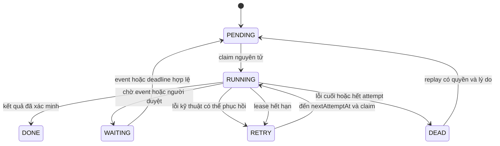

WAITING là kết quả của lượt điều phối, không phải để một execution ngủ nhiều ngày. Human approval, tiền đến và deadline được lưu backend/Bridge. Đăng ký wait condition và checkpoint trong cùng transaction của Bridge; trước khi chờ phải kiểm durable event inbox/nguồn để không mất event đến sớm. Wakeup giữ workflowVersion và operation key; command mới độc lập tạo job mới có causationId. DONE là hoàn tất job kỹ thuật, không được suy ra Enrollment đã CONFIRMED hay erasure đã COMPLETED.

### 2.2 Claim, checkpoint, retry và quyền

1. Bridge nhận broker event, ghi inbox bền trước ack; xử lý inbox và tạo job cùng transaction, unique theo `(eventId, workflowId)`; version được ghim lúc tạo, không tạo job thứ hai chỉ vì deploy version mới.
2. Trigger Schedule n8n poll claim mỗi 5 giây khi còn slot. Claim SQL lock/CAS trả tối đa một job/lượt, tối đa 2 execution nghiệp vụ toàn instance; Bridge giới hạn lease đang hoạt động làm kiểm soát cuối cùng. Không dùng Webhook n8n public thay durable ingress của Channel/Payment.
3. Lease 60 giây; checkpoint gia hạn sau mỗi bước. HTTP timeout 10 giây, LLM tổng tối đa 20 giây. Worker hết lease phải dừng; Bridge reject checkpoint/result/command authorization từ attempt cũ. Backend còn kiểm business version/idempotency để chặn hiệu ứng stale giữa hai lời gọi.
4. Mỗi command ghi intent và key trước gọi, key ổn định theo job/step/business operation, không theo executionId/attempt. Backend trả operationId và hỗ trợ tra cứu; mất phản hồi thì tra theo key/operation trước resend. Không nhả hold/chốt hoàn dựa trên timeout chưa rõ kết quả.
5. HTTP 429/5xx/network: Bridge lên lịch tối đa 8 attempt, backoff 2–300 giây; tôn trọng Retry-After. Không bật retry riêng ở node để nhân lần gọi. HTTP 400/403/schema sai là lỗi cần sửa/handoff; 409 đọc version/trạng thái và quyết định nhánh, không PUT lặp mù.
6. Event cũ/version thiếu: đọc snapshot nguồn; version thấp không ghi đè, version thiếu cần đồng bộ rồi tiếp tục. Replay cùng job/key, ghi người/lý do/attempt; không dùng JSON sửa tay để nâng quyền.
7. Internal machine principal do IAM cấp, audience/scope theo API; contextRef không thay được confirmation/approval do backend lưu. Mỗi service kiểm quyền người khởi tạo hiện hành, ownership, branch, policy và trạng thái trước tác động. Tác vụ hệ thống dùng quyền hệ thống được allowlist cụ thể, không giả phiên nhân viên.
8. Sau khi job DONE/DEAD đã ghi DB, execution có thể được prune; còn event, operation, audit và evidence đã che để đối chiếu. Không tuyên bố exactly-once delivery; hiệu ứng nghiệp vụ được bảo vệ bằng transaction/dedup/idempotency.

Mọi WF bên dưới **kế thừa** timeout/retry/lease/checkpoint/permission/replay của mục này. Mỗi WF ghi thêm điều kiện chờ/bù trừ riêng; lỗi quyền không được biến thành nhánh retry vô hạn. Luồng hiện có không dùng Bridge tiếp tục chạy đến khi nghiệm thu migration; chỉ bật một owner điều phối cho mỗi event/workflow version.

### 2.3 Contract thực tế N8N-02 LOCAL

- Job ingress chỉ qua RabbitMQ/backend; inbox dedup, tạo job và inbox DONE trong một transaction trước ack. `(eventId,workflowId)` unique; workflowVersion ghim lúc tạo.
- Internal API kiểm RS256 issuer/audience `automation-bridge`, TTL ≤300 giây, scope và allowlist workflow/subject. N8N-03 bổ sung mandatory live IAM introspection/revocation; smoke dùng IAM HTTP issuer thật với key/DB test biệt lập. Token đọc theo job 30s và backend tra quyền/branch/ownership đã có, [12/12 acceptance LOCAL](ban-giao-n8n-03.md). Thiếu authority → 503. Confirmation/approval/command nghiệp vụ còn chờ service nguồn, fail-closed.
- Claim tối đa 2 lease toàn DB, lease 60 giây. `attempt` tăng đơn điệu mỗi lần cấp lease để fence; **failureCount** mới là ngân sách tối đa 8 lỗi kỹ thuật, không tăng khi human wait. Checkpoint/result yêu cầu owner/token/attempt/expectedVersion còn hạn.
- Checkpoint lưu `operation:{name,operationId?,resultRef?}`, Bridge trả key ổn định `automation:<jobId>:<name>`. Retry/replay giữ job/checkpoint/key/version. Backend nguồn vẫn phải có command idempotency/lookup; chưa có workflow nghiệp vụ gọi chúng.
- WAITING cần `waitFor:{type,entityId}` + `deadlineAt`; durable inbox match thêm correlationId, loại event đã tiêu thụ cho job. Event sớm được wake cùng transaction; deadline được maintenance/claim wake theo DB server time.
- RETRY chỉ cho NETWORK_ERROR/TIMEOUT/UPSTREAM_UNAVAILABLE/RATE_LIMITED; backoff 2–300 giây, tôn trọng retryAfterSeconds tối đa 86400. Hết ngân sách → DEAD/audit. Replay chỉ DEAD + IAM center_director hiện hành + reason 10–500 ký tự + expectedVersion, audit transactional. Gateway không forward Bridge.
- [Workflow smoke](../workflows/n8n/bridge-smoke.json) chỉ manual claim → checkpoint → result, không có nghiệp vụ hoặc subflow SW-API/SW-ERROR/SW-NOTIFY. 11 integration tests và execution thật được ghi trong [bàn giao](ban-giao-n8n-02.md).

### 2.4 Sub-workflow dùng chung (thiết kế, chưa triển khai)

| Mã | Input → output | Trách nhiệm |
| --- | --- | --- |
| SW-API | job/contextRef/allowlisted command/operation key → operation/resultRef | Kiểm lease, lấy quyền máy ngắn hạn, timeout, lookup sau lỗi, checkpoint; không nhận URL tùy ý từ model |
| SW-ERROR | job/step/errorCode → WAITING/RETRY/DEAD + alertRef | Phân loại lỗi, đề nghị Bridge schedule retry, tạo alert qua Notification API, che dữ liệu |
| SW-NOTIFY | event/recipientRef/templateVersion → intentRef | Gọi Notification tạo intent dedup; delivery qua WF-10, không gửi email trong transaction khác |

SW-ERROR không gửi alert qua chính WF lỗi theo vòng lặp: Bridge lưu DEAD/alert một lần, Portal Operations còn đọc được khi Notification lỗi; alert email có key riêng và không phát alert mới cho chính alert đó.

### Actual N8N-04 ngày 08/11

Cập nhật 09/11: **LOCAL chỉ đọc** — model free cố định đã gọi Catalog/Class thật qua
n8n; [benchmark 10/10](../workflows/n8n/chat-benchmark-review.json), browser và fault
tests có [evidence mới](ban-giao-n8n-04.md). Key gate đã gỡ, production/human review
và workflow ngoài lát cắt này chưa được mở. Đoạn 08/11 dưới đây là snapshot lịch sử.

WF-01/02/03 đã có [JSON/manifest](../workflows/n8n/chat-manifest.json) và
[API/contract Conversation](../services/conversation/README.md). Đây là lát cắt web
chỉ đọc, **PARTIAL**: kỹ thuật n8n/missing-key + backend/browser có evidence mới tại
[bàn giao N8N-04](ban-giao-n8n-04.md), chưa nghiệm thu model thật/benchmark. WF-04–12
và các subflow chung rộng hơn vẫn là thiết kế. Mô tả phía trên là snapshot 04/11.
Đối chiếu API thực tế trong runbook trước khi dùng endpoint thiết kế phía dưới.

## 3. Đặc tả 12 workflow

### WF-01 — Tiếp nhận và trả tin đa kênh

- **Trigger/điều kiện:** inbox Channel đã xác thực và lưu bền; phiên web chat hoặc provider/account/messageId hợp lệ. Nhánh outbound nhận `conversation.message_out`, không lấy câu trả lời trực tiếp từ LLM.
- **Input → output:** channelMessageRef/channel/account/branchMapping/version → conversationId/messageId/routing result; outboundRef → deliveryRef và queued/sent/delivered/failed/unknown.
- **API/event:** Channel receive/delivery và Conversation append/route/send là API đề xuất; CRM resolve định danh kênh phải bổ sung vào CRM hiện có; producer/consumer outbox/inbox. Không sửa trực tiếp `crm_people`.

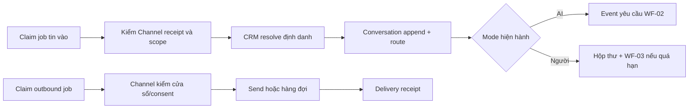

- **Quyền/người xử lý:** machine Channel/Conversation giới hạn tenant/branch/account; tuyển sinh xem hàng đợi đúng branch. Chưa biết branch thì vào hàng đợi phân loại được cấp quyền, không tự đoán chi nhánh bằng LLM.
- **Chờ/timeout/retry:** chờ delivery hoặc người phân loại; provider timeout không rõ thì lookup nếu provider hỗ trợ, nếu không giữ UNKNOWN cho người xử lý; không gửi lặp mù.
- **Bù trừ:** không xóa tin đã nhận; sai route sửa qua Conversation có audit/version, không nhân bản lịch sử chéo branch.
- **Nghiệm thu:** gửi cùng webhook hai lần, reconnect widget, sai phiên/branch/token, reply hai chiều và ngoài cửa sổ. Cùng tin chỉ một bản ghi; không lộ lịch sử người khác. Facebook/Zalo phải có execution + tin thật nếu gọi là live.

### WF-02 — AI tư vấn, tra cứu và đề nghị thao tác

- **Trigger/điều kiện:** `conversation.ai_requested`; Conversation đang AI mode và version/message watermark phù hợp, consent đúng mục đích. Lần 1 chỉ đọc Catalog/Class; create enrollment tool chưa được bật.
- **Input → output:** conversation/contextRef + nhu cầu đã che → draftRef, sourceRefs/readAt, prompt/model/workflow version, tool log hoặc handoffRef. Đề nghị mua tạo confirmation request tại backend; chỉ confirmationRef đã lưu mới kích hoạt WF-05.
- **API/event:** GET `/api/v1/courses`, `/api/v1/packages`, `/api/v1/packages/:id/quote`, `/api/v1/classes` là nguồn hiện hữu cần kiểm scope/filter; FAQ retrieval version và Conversation context/submit-draft/send-guard là API cần bổ sung. Không lấy giá/chỗ từ RAG.

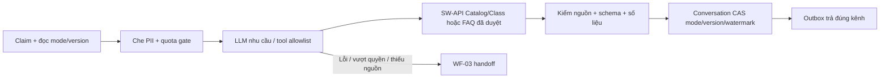

- **Quyền/người xử lý:** agent chỉ context khách hiện hành, đọc catalog/lớp; quyền tạo đơn theo confirmationRef và API backend. Tuyển sinh xử lý khi không chắc chắn; model không được đổi tool URL, branch hay actor.
- **Chờ/timeout/retry:** tối đa 2 câu hỏi/lượt, 4 tool call, 20 giây/turn; thiếu nhu cầu thì chờ tin khách mới, thiếu quota/429 thì thông báo chờ/handoff, không gọi model trả phí. Hai conversation không dùng chung memory key.
- **Bù trừ:** draft cũ bị loại khi đổi mode/version/watermark; không gửi tự động lại. Model timeout chưa tạo đơn; nếu tool mutating sau này timeout phải lookup như SW-API.
- **Nghiệm thu:** 10 ca trước lần 1, 50 ca gán nhãn trước final; không có lớp, policy RAG version, prompt injection, hai khách, tool lỗi, đổi giá, nhân viên nhận lúc model đang chạy. Mọi số liệu có nguồn/thời điểm; stale draft không gửi.

### WF-03 — Tiếp quản, hàng đợi và escalation

- **Trigger/điều kiện:** handoff_requested, nhân viên bấm nhận/đổi mode, hoặc queue deadline do server xác định. Nhân viên bấm nhận phải được Conversation CAS ngay tại API; n8n điều phối hậu xử lý, không trì hoãn khóa gửi AI đến lúc poll.
- **Input → output:** conversationRef/expectedVersion/requestRef hoặc deadlineRef → owner/mode/version mới, queueRef/notificationIntentRef.
- **API/event:** Conversation claim/release/transfer/queue-due và Org/IAM assignees; các lệnh Conversation là API mới, IAM assignees hiện có cần giữ scope. `conversation.owner_changed`, `conversation.handoff_requested` là contract mới.

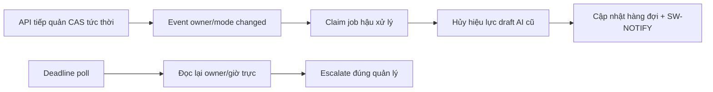

- **Quyền/người xử lý:** tuyển sinh nhận trong branch; quản lý phân công/chuyển theo scope; không tự trả AI sau timeout. Quản lý hàng đợi xử lý quá hạn/ngoài giờ.
- **Chờ/timeout/retry:** deadline nhận đề xuất 5 phút trong giờ trực, ngoài giờ phản hồi rõ; chờ người nhận bền ở Conversation. 409 nghĩa đã có người nhận, hiển thị owner mới; không lặp claim cưỡng chế.
- **Bù trừ:** chuyển nhầm cần thao tác có quyền/lý do và version mới; không khôi phục AI cũ tự động.
- **Nghiệm thu:** hai người nhận cùng lúc một người thắng, AI đang soạn bị chặn, chuyển branch không lộ lịch sử trái quyền, escalation chỉ một intent và không chạy khi đã có owner.

### WF-04 — Hồ sơ, consent, lead và merge

- **Trigger/điều kiện:** yêu cầu CRM từ Portal/chat đã xác minh hoặc event Channel cần liên kết. Consent ADMISSIONS hiện hành mới tiếp tục lead; tư vấn chung không bị ép consent marketing.
- **Input → output:** contact/learner/payer refs, identityRef, consentRef, lead command/version, mergeApprovalRef nếu có → people/relationship/lead refs hoặc conflictRef.
- **API/event:** CRM hiện có `/api/v1/crm/people`, `leads`, `relationships`, consent/erasure; thêm resolve-channel và merge plan/approve/execute có conflict report. Các lệnh CRUD đã có không chuyển sang ghi DB từ n8n.

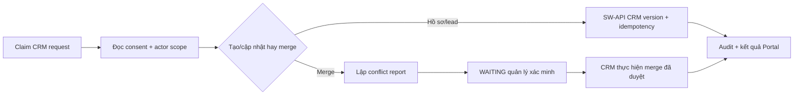

- **Quyền/người xử lý:** tuyển sinh quản lead được giao, quản lý phân công/quan hệ/merge; không coi người trả là learner. CRM backend kiểm lại branch/quyền tại thời điểm ghi.
- **Chờ/timeout/retry:** chờ người xác minh quan hệ/merge; cập nhật version lỗi thì tải lại detail; không retry để ghi đè. Consent thu hồi trong lúc chờ phải chặn tiếp tục nghiệp vụ cần consent.
- **Bù trừ:** không tự xóa people khi bước tạo lead lỗi; giữ hồ sơ và trả conflict/partial result. Merge phải có mapping/audit, không undo bằng cách tách SQL thủ công.
- **Nghiệm thu:** claim lead đồng thời, contact trả thay, cùng số liên hệ không tự merge, stale edit giữ ghi chú, thu hồi consent và merge sai branch bị chặn.

### WF-05 — Xác nhận mua, tạo đơn, giữ chỗ và QR

- **Trigger/điều kiện:** `enrollment.requested` từ confirmationRef do Portal/Conversation lưu. Xác nhận ghi learner/class/package/quote version/điều khoản; không chấp nhận chỉ chuỗi “đồng ý” do LLM tự diễn giải không gắn offer cụ thể.
- **Input → output:** confirmationRef/learnerRef/classRef/packageRef → enrollmentRef/snapshot/holdRef/expiresAt/paymentRequestRef/QR hoặc trạng thái cần xác nhận lại.
- **API/event:** Enrollment create/snapshot/transition/operation lookup là API mới; Catalog quote hiện có; Class hold nguyên tử hiện có cần nối quyền nội bộ an toàn; Payment create QR/lookup mới. Không đưa endpoint commit nội bộ hiện có ra public.

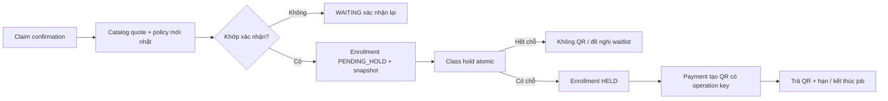

- **Quyền/người xử lý:** tuyển sinh/agent theo confirmationRef đúng learner/context; Catalog quyết số tiền, không tin client. Người xếp lịch/giám đốc quyết điều kiện OPEN, không để workflow mở lớp.
- **Chờ/timeout/retry:** QR hạn không dài hơn hold khi provider hỗ trợ; hạn hold do Class server. Job WF-05 kết thúc sau khi ghi kết quả QR; tiền đến tạo job WF-06, deadline tạo job WF-07. Chờ tiền bằng backend state/event, không giữ n8n Wait node làm nguồn hạn duy nhất. Nếu cần xác nhận lại quote đã đổi, kết thúc yêu cầu cũ ở trạng thái cần xác nhận; xác nhận mới tạo request/job mới gắn causationId, không tái dùng key với payload khác.
- **Bù trừ:** lỗi QR xác định không phục hồi thì hủy request khi có thể, nhả hold idempotent và kết thúc đơn theo API. Timeout chưa rõ phải lookup QR/hold trước, không nhả rồi để một QR chưa biết trạng thái tiếp tục nhận tiền âm thầm; tiền muộn đi WF-07.
- **Nghiệm thu:** last-seat race, retry tạo đơn/QR, timeout sau server commit, policy đổi sau xác nhận, lớp chưa OPEN. Không có hold không phát QR, snapshot cũ bất biến.

### WF-06 — Nhận tiền matched và xác nhận chỗ

- **Trigger/điều kiện:** Payment đã xác thực webhook, lưu ledger bền, dedup và đối chiếu đủ điều kiện rồi phát `payment.matched`. n8n không nhận trực tiếp webhook ngân hàng để tự đánh dấu đã thanh toán.
- **Input → output:** paymentMatchRef/enrollmentRef/transactionRef → committed entitlementRef + Enrollment CONFIRMED hoặc exceptionRef.
- **API/event:** Payment match lookup; Enrollment transition CONFIRMING/CONFIRMED; Class commit/lookup; `enrollment.confirmed` là event để CRM/Reporting/Notification xử lý.

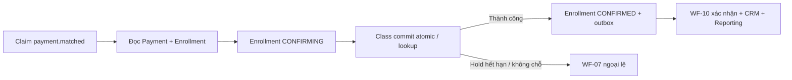

- **Quyền/người xử lý:** machine payment-match chỉ dùng matchRef backend đã xác minh; agent/tuyển sinh không được tự tạo match. Kế toán xử lý ngoại lệ.
- **Chờ/timeout/retry:** commit timeout lookup trạng thái Class; nếu commit đã thành công thì tiếp tục Enrollment transition, không commit chỗ mới. Event lặp trả cùng kết quả.
- **Bù trừ:** nhận tiền là sự kiện thật không xóa ledger. Không chốt được chỗ thì yêu cầu phương án hoàn/chuyển, không tự công bố CONFIRMED và không tự động hoàn vì n8n lỗi mạng.
- **Nghiệm thu:** webhook/event lặp, expire vs commit, kill sau commit trước Enrollment confirm, hai giao dịch thật. Chỉ có một entitlement; xác nhận không phát sớm; tổng tiền giữ đúng ledger.

### WF-07 — Hết hạn, hủy chưa thu và ngoại lệ tiền

- **Trigger/điều kiện:** event hold expired/enrollment cancel/payment review hoặc cron liệt kê deadline từ API. Class phải tự từ chối hold hết hạn theo server time dù n8n đang tắt.
- **Input → output:** expiry/reviewRef, payment/enrollment/version, quyết định kế toán nếu có → EXPIRED/CANCELLED/CONFIRMING/REFUND_PENDING hoặc UNALLOCATED review có owner/deadline.
- **API/event:** Class expire/lookup/acquire-again; Payment allocation/review/cancel-request/manual-receipt; Enrollment transition. Thu thủ công PAY-7 có chứng từ/duyệt riêng, không tạo webhook provider giả.

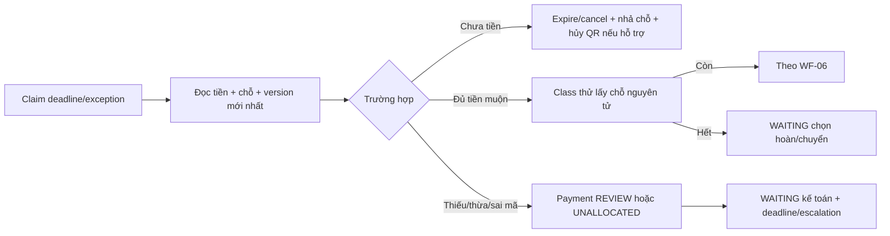

- **Quyền/người xử lý:** kế toán phân bổ/review, quản lý duyệt ngoại lệ theo policy; khách chọn phương án có xác nhận. Không tự gán đơn theo số tiền giống nhau.
- **Chờ/timeout/retry:** REVIEW đề xuất tối đa thêm 24h một lần nếu policy duyệt; không tự kéo dài hold, deadline review không phải quyền giữ chỗ. Cron event duplicate được dedup theo resource/deadline version.
- **Bù trừ:** hủy QR không hoàn tác tiền đã về; tiền muộn vẫn ghi nhận và chuyển review/hoàn/chuyển. Không có chỗ không tạo enrollment confirmed.
- **Nghiệm thu:** thiếu/thừa/sai mã/hai chuyển khoản, hủy vs tiền đến, review quá hạn, workflow tắt qua thời hạn. Tổng chỗ/ledger vẫn đúng và mọi ngoại lệ có owner.

### WF-08 — Giờ rảnh, đề nghị nghỉ, thay đổi/hủy lớp

- **Trigger/điều kiện:** quyết định teacher-time hoặc đề nghị đổi/hủy có version/lý do. API ghi yêu cầu/duyệt trước; workflow không tự duyệt. Giờ rảnh hiện có vẫn có hiệu lực theo backend ngay khi hợp lệ.
- **Input → output:** requestRef/approvalRef/classRef/expectedVersion → changePlanRef, scheduleVersion/lifecycle mới, affectedEnrollmentRefs và notification intents.
- **API/event:** teacher-time/classes hiện có; thêm impact plan/apply cho lớp có quyền lợi và event schedule.changed/class.cancelled có version. Không bỏ chặn ENROLLMENT_REQUIRED hiện có trước khi workflow quyền lợi đạt acceptance.

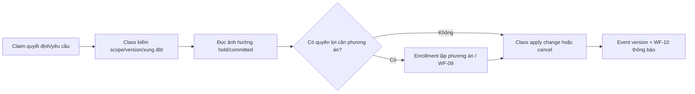

- **Quyền/người xử lý:** giảng viên tự khai/nghỉ; quản lý đúng branch duyệt; không tự duyệt nghỉ. OPEN/start/complete theo quyền hiện có. Quản lý xếp lại buổi trước khi duyệt nghỉ gây xung đột.
- **Chờ/timeout/retry:** chờ duyệt hoặc phương án quyền lợi; version stale phải tính impact lại. Không giữ transaction Class trong thời gian chờ khách/quản lý.
- **Bù trừ:** đổi/hủy lưu lịch sử, không xóa buổi hoặc ghi đè snapshot; chỉ nhả quyền lợi khi Enrollment xác nhận hủy có hiệu lực, không chờ đến hoàn xong. Thay đổi lỗi cần kế hoạch sửa mới, không PUT lùi version mù.
- **Nghiệm thu:** race duyệt nghỉ/xếp lịch, cancel/commit, đổi lịch có hold/committed, sĩ số tối thiểu/học bù, nhắc lịch cũ bị chặn; không mất quyền lợi khi bước sau lỗi.

### WF-09 — Hoàn, chuyển lớp, bảo lưu và waitlist

- **Trigger/điều kiện:** request đã xác minh và approvalRef phù hợp; waitlist invitation khi có chỗ và consent. Policy/quote/chênh lệch phải có version, hạn và lựa chọn khách lưu backend.
- **Input → output:** adjustmentRef/type/sourceEnrollment/targetClass/approvalRef → refund executionRef, transfer/suspension entitlement hoặc invitationRef có hạn.
- **API/event:** Enrollment adjustment/transition/lookup; Class acquire/commit/release; Payment refund request/approve/record-execution/lookup; tất cả lệnh mới trừ primitive Class đã có.

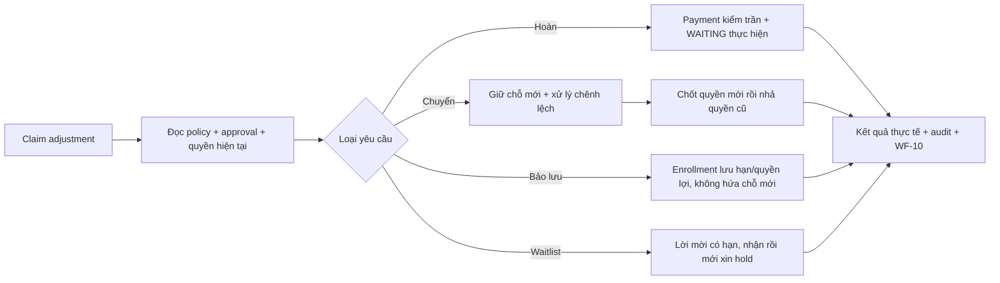

- **Quyền/người xử lý:** kế toán lập/ghi thực hiện; giám đốc đúng scope duyệt; người lập không tự duyệt. AI chỉ thu nhu cầu và chuyển người. Hoàn demo thực hiện thủ công có mã chuyển khoản thực tế nếu dùng tiền thật.
- **Chờ/timeout/retry:** approval/bằng chứng/chênh lệch/lời mời có hạn lưu backend; không giữ execution. Lookup mọi bước mutating trước retry, nhất là hoàn. Chỉ REFUNDED khi đủ bằng chứng khoản duyệt đã thực hiện.
- **Bù trừ:** chuyển lỗi trước chốt quyền mới thì hủy hold mới, giữ quyền cũ; lỗi sau bước đã chốt cần tiếp tục hoặc bù trừ theo adjustment plan bền, không tự nhả cả hai. Hoàn tiền dư không nhả chỗ học còn hiệu lực. Hết hạn invitation không tự giữ chỗ.
- **Nghiệm thu:** tự duyệt bị chặn, hoàn lặp/hoàn vượt tiền, chuyển hết chỗ hoặc timeout giữa hai bên, bảo lưu hết hạn, hai người nhận lời mời tranh chỗ cuối.

### WF-10 — Thông báo, nhắc học, OTP và hóa đơn mô phỏng

- **Trigger/điều kiện:** notification intent đã xác định recipient/template; enrollment.confirmed cho xác nhận học; cron lấy reminder due theo scheduleVersion; IAM yêu cầu OTP; Payment yêu cầu hóa đơn mô phỏng đã đủ điều kiện.
- **Input → output:** intentRef/templateVersion/recipientRef/sourceVersion → delivery receipt hoặc UNKNOWN/FAILED có owner; OTP chỉ deliveryRef, không đưa mã vào execution log; invoice trả fileRef có guard.
- **API/event:** Notification create/claim/send/lookup/receipt mới; Channel outbound dùng adapter; IAM OTP issue/verify mới; Payment invoice render/download mới. Model không nhận email/định danh hóa đơn hoặc OTP.

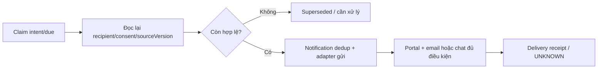

- **Quyền/người xử lý:** service Notification chỉ recipientRef thuộc intent; IAM tự kiểm learner OTP/ownership, rate limit và lưu hash; kế toán xử lý invoice, tuyển sinh xử lý delivery. Link lớp/file phải qua backend kiểm quyền, không public chỉ vì biết URL.
- **Chờ/timeout/retry:** delivery retry theo mục 2. SMTP không hỗ trợ tra cứu/dedup hoàn toàn thì ghi UNKNOWN, chuyển người trước resend có nguy cơ trùng; không hứa exactly-once email. OTP hết hạn xác định tại IAM, không phụ thuộc cron.
- **Bù trừ:** intent sai version hủy/supersede trước gửi; tin đã gửi không thu hồi giả, gửi đính chính version mới nếu có quyền. Không gửi xác nhận học khi chỉ nhận payment.matched.
- **Nghiệm thu:** retry intent, lịch đổi/hủy trước nhắc, consent rút, SMTP lỗi/timeout, OTP sai/lặp/hết hạn, invoice ownership. Portal + hộp thư thử nhận thật; mail sink chỉ tính test local.

### WF-11 — Báo cáo, đối soát và nhập dữ liệu

Lát cắt báo cáo local dùng `reporting.refresh_requested` từ outbox Enrollment/Payment. WF‑11 claim qua Bridge, gọi Reporting bằng scope `reporting:project` và ghi kết quả qua lease. Reporting đọc aggregate từ API nguồn với scope riêng, giữ checkpoint event/ngày và dựng lại theo kỳ. Cron đối chiếu ngày hôm trước lúc 02:15 Asia/Saigon. [Manifest inactive](../workflows/n8n/reporting-manifest.json) · [Định nghĩa và bằng chứng](acceptance-portal-wf11.md).

- **Trigger/điều kiện:** event projection đã lưu, cron đối soát ngày theo Asia/Ho_Chi_Minh, import request có batchRef/approved mapping. Reporting sở hữu event store/read model, n8n gọi API project/rebuild/compare, không tự giữ checkpoint duy nhất.
- **Input → output:** sourceEventRef/checkpoint, reconciliationPeriod hoặc importBatchRef → projection/checkpoint/lag, difference report, batch counts/errors/mapping/rollback result.
- **API/event:** Reporting ingest/project/rebuild/compare mới; Payment reconciliation/transaction lookup; import dry-run/apply/rollback qua API CRM/Class/Enrollment/Payment tương ứng. Không dùng một SQL node ghi nhiều DB.

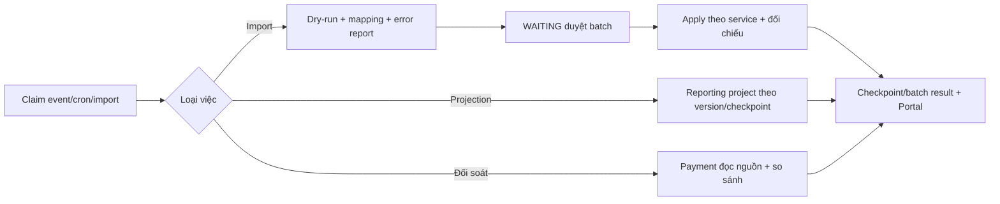

- **Quyền/người xử lý:** kế toán xem đối soát, quản lý xem báo cáo theo scope; người vận hành duyệt mapping. Không mặc định cho n8n đọc toàn bộ chat hoặc statement; source export giới hạn dữ liệu.
- **Chờ/timeout/retry:** chờ duyệt batch/chênh lệch; event sai thứ tự đọc nguồn/checkpoint rồi hội tụ. Replay cùng batch/event không cộng lại tiền/lead. Đối soát không hoàn tất chỉ vì đã gửi email.
- **Bù trừ:** rollback batch chỉ qua API chủ dữ liệu và theo dependency; bản ghi đã có quyền lợi/giao dịch phải review, không delete mù. Import tiền lịch sử lưu provenance, không phát payment.received mới giả. Read model dựng lại được từ event store hoặc snapshot+delta có retention.
- **Nghiệm thu:** U18/U19: nguồn khớp chỉ số/branch/kỳ; hoàn sau kỳ cũ, event lặp/thiếu, rebuild, import lỗi giữa batch, dry-run không ghi nghiệp vụ. Dashboard bỏ mock; fixture có nhãn và mapping.

### WF-12 — Xóa/ẩn danh, cảnh báo và phục hồi

Hai nhánh WF‑12 có canonical inactive. Hồ sơ local ghi replay có audit qua Portal, restore trên instance sạch và xóa/ẩn danh theo policy demo. [Runbook](runbook-wf12.md) · [Evidence](../workflows/n8n/wf12-evidence.json).

- **Trigger/điều kiện:** CRM erasure đã được quản lý xác minh, retention deadline; Bridge job DEAD/lease quá hạn/health alert hoặc replay operator. Hai nhánh erasure/recovery có scope khác nhau, dùng chung registry/evidence, không dùng quyền xóa để replay.
- **Input → output:** erasureRef/taskRefs hoặc failedJobRef/reason/operatorRef → kết quả/bằng chứng từng nơi hoặc job recovery receipt có audit; không trả raw payload sự cố ra UI.
- **API/event:** CRM erasure request/task APIs hiện có; thêm erasure/export-proof tại Conversation/Enrollment/Payment/Reporting/backup registry; Bridge replay/health/job lookup mới. Giữ messaging replay Class hiện có riêng, không nhầm DB DEAD với broker DLQ.

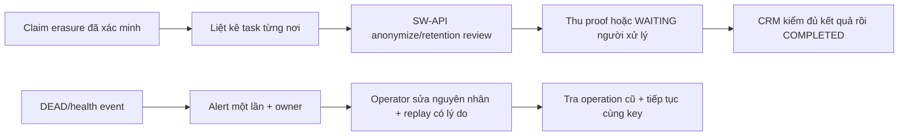

- **Quyền/người xử lý:** quản lý xác minh erasure; chủ dữ liệu xử lý nghĩa vụ giữ chứng từ/backup theo C09; center director/operator được scope riêng mới replay. Không cho workflow tự sửa audit append-only.
- **Chờ/timeout/retry:** mỗi erasure task có owner/deadline/proof; chưa đủ thì PROCESSING, không tự coi không áp dụng. Backup chưa hết retention có task chờ và quy trình áp dụng suppression khi restore; không báo đã xóa backup khi chưa xử lý. DEAD chỉ replay sau sửa nguyên nhân và kiểm lại quyền/approval.
- **Bù trừ:** xóa thật có thể không đảo được, luôn plan/scope và xác minh trước. Restore phải áp dụng lại erasure/suppression, reconcile money/seat và job checkpoint trước mở bán. Replay không đổi eventId/operation key để tạo hiệu ứng mới.
- **Nghiệm thu:** thiếu proof giữ PROCESSING; lỗi một service/backup và restore không làm PII sống lại; job poison đi DEAD, quyền thiếu bị chặn, replay sau API thành công không nhân đôi. Kill broker/DB/n8n có receipt phục hồi; log không lộ secret.

## 4. Gói workflow, credential và import

### 4.1 Cấu trúc bàn giao dự kiến

`workflows/n8n/` đã có runtime smoke tổng hợp và runbook cho N8N-01; trạng thái/chứng cứ tại [bàn giao](ban-giao-n8n-01.md). Các JSON WF-01–12, manifest nghiệp vụ và credential scope tương ứng chỉ thêm khi triển khai thực; canvas không chạy không phải bằng chứng.

Manifest mỗi workflow gồm WF/subflow ID, version, JSON path/checksum, trigger, input schema version, các subflow dependency, node type/version, n8n image version đã thử, credential alias, expected scopes và bộ ca acceptance. Pin job theo workflowVersion; giữ bản cũ đến khi các job đang chờ hoàn tất hoặc có migration được review. Publish version mới không tự đổi luồng của job cũ.

| Alias credential / cấu hình | Nơi dùng | Nguồn cấp / quy tắc |
| --- | --- | --- |
| `bridge-runtime` | Claim/checkpoint/result | IAM service principal audience Bridge; không dùng tài khoản admin nhân viên |
| `domain-runtime` | SW-API | Token giới hạn audience/scope/context ngắn hạn; backend xác minh lại |
| `llm-free-demo` | WF-02 | Key tài khoản free của nhóm; model/quota config, không paid fallback |
| `N8N_ENCRYPTION_KEY`, DB connection | Runtime | Operator tạo/lưu ngoài Git; key backup riêng, DB/user n8n riêng |
| Facebook/Zalo tokens/secrets | Channel backend | Chủ Page/OA cấp; mặc định không lưu trong n8n, chỉ credential reference của adapter |
| SePay auth/lookup secret | Payment backend | Chủ tài khoản cấp; n8n chỉ dùng payment refs, không thấy sao kê raw |
| SMTP credential | Notification backend | Hộp thư thử; n8n gọi Notification API |
| Domain/TLS/proxy URLs | Runtime/BFF/adapter | Operator cấu hình callback URL đúng môi trường, không hardcode token trong URL |

Một alias không đồng nghĩa chia sẻ một token toàn quyền cho mọi workflow. Browser chỉ đi BFF/Gateway; không cấp credential n8n cho frontend. Không export credential dạng plaintext, không commit execution dump hoặc `.env` cá nhân.

### 4.2 Runbook clean import và chạy lại

1. Dùng môi trường biệt lập với PostgreSQL/broker/test DB, image n8n đúng manifest, key riêng; ghi version và trạng thái trống. Không xóa volume demo đang dùng để tạo instance sạch.
2. Build/migrate/seed các service cần thiết theo runbook của service, tạo fixture UUID DEMO. Chuẩn bị IAM machine principal, backend provider test credential và Bridge mapping workflow đã allowlist.
3. Import JSON sub-workflow bằng editor **Import from File** trước, sau đó workflow cha; remap subflow IDs và credential aliases theo manifest. Không giả định ID từ instance nguồn tồn tại ở instance mới.
4. Gắn credential bằng UI riêng, kiểm node/version; cấu hình base URL nội bộ, model miễn phí, concurrency, retention và timezone. Smoke SW-API với lệnh chỉ đọc và một lệnh idempotent trong test DB.
5. Publish/activate trigger theo thao tác được ghi cụ thể cho phiên bản ghim trong runbook bàn giao. Bật Bridge binding/poll sau khi subflow và consumer đã sẵn sàng; tạo event qua API nguồn, không chèn SQL job nghiệp vụ tùy ý.
6. Chạy từng WF thành công + nhánh lỗi, ghi job/event/correlation/operation IDs; kiểm kết quả bằng API/backend DB test chứ không chỉ node xanh. Chạy N02/N03 để kiểm lease/restart trước tác vụ tiền thật.
7. Chạy provider sandbox rồi live theo gate đã duyệt; ghi loại môi trường. Token chưa được cấp là BLOCKED. Chỉ sau kiểm auth/dedup mới làm giao dịch thử nhỏ có chủ tài khoản theo dõi.
8. Deactivate poll/trigger trước nâng phiên bản, để hoàn tất hoặc checkpoint các job đang chạy. Backup DB/key/config, giữ phiên bản cũ. Không rollback bằng cách đảo migration phá dữ liệu hoặc tạo operation key mới.
9. Dọn đúng process/DB/fixture do test tạo, giữ evidence đã che. Thử restore vào instance biệt lập và chạy lại từ checkpoint để chứng minh workflow export + dữ liệu/key/config đủ phục hồi.

Workflow JSON không chứa toàn bộ credential, job DB hoặc state nghiệp vụ; cần backup instance và source DB riêng. Nguồn: [n8n migration FAQ](https://support.n8n.io/article/migrating-from-cloud-to-self-hosted), [self-host examples](https://github.com/n8n-io/n8n-hosting).

## 5. Evidence và tiêu chí hoàn thành

Mỗi WF bàn giao index: commit; image/node/JSON/workflow version; input fixture; credential aliases không secret; expected/actual; thời điểm; execution/job/event/correlation/operation IDs; nguồn API/DB; nhánh thành công/lỗi; kết quả permission/retry/restart liên quan; người thực hiện và reviewer. Artifact lớn/riêng tư nằm ngoài Git, index chỉ trỏ bản đã che được phép chia sẻ.

| Mốc | Bằng chứng tối thiểu |
| --- | --- |
| 11/11 lần 1 | WF-01/02/03 web chat thật; AI live/model ID/tool source; handoff race; tool/quota error; clean import; các gate/blocker |
| Vòng đăng ký | WF-04/05/06/07 + N02/N03; giữ chỗ/QR/ledger/commit; event trùng và restart; bằng chứng live SePay riêng khỏi sandbox |
| Vòng mở rộng | WF-08/09/10; phê duyệt và bù trừ; delivery/version; Student OTP/ownership; Facebook/Zalo thật nếu đủ quyền |
| Final | WF-01–12, U01–U20/N01–N12; read model/import/erasure/restore; 50 ca AI; mỗi chức năng M0–M4 có actual state |

DEMO-PASS cần tất cả API/UI/workflow/dữ liệu bền của phạm vi đó, execution import được và acceptance đạt. Canvas, screenshot, mail sink, webhook tự bắn hoặc video không thay bằng chứng tích hợp live. Có skip/thiếu quyền/thiếu proof thì ghi PARTIAL/BLOCKED, không đổi số test thành tỷ lệ hoàn thành sản phẩm.
