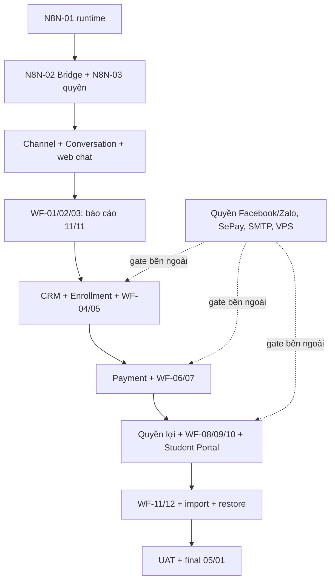

# Phân công v3 — một người chính, hai người hỗ trợ

<!-- CURRENT_N8N_LINK -->
Hiện hành 16/11/26: **N8N-05 ACCEPT_LOCAL** — WF04–07 tổng hợp local, 49/49 nhóm tích hợp cuối và affected regressions đạt. [Matrix](acceptance-n8n-05.md), [evidence index](../workflows/n8n/registration-evidence.json), [bàn giao](ban-giao-n8n-05.md). **N8N03/04 ACCEPT local** giữ theo [hồ sơ lịch sử](acceptance-n8n-03-04.md). Canonical inactive; provider/live/production và WF08–12 vẫn đóng. Các snapshot có ngày bên dưới giữ quyết định tại thời điểm ghi; các ticket cha không được coi hoàn tất chỉ từ lát cắt N8N05.

Lịch sử kiểm chứng đến 11/11/2026 — giữ nguyên receipts và quyết định cũ

## Sửa VI-02 và benchmark mới — 11/11/2026 03:49 (+07:00)

**Codex chấp nhận phần sửa policy/version đã kiểm synthetic; toàn N8N-04 vẫn
PARTIAL / NOT_ACCEPTED, model pilot NO_GO, khách thật BLOCKED.** Người dùng đã
cấp quyền đọc quota/generation metadata, xử lý Docker và nghiệm thu; grant mới
prior22/max18/trần40/0USD, retry/probe/fallback0. Engine29.1.3 đang sẵn sàng,
không cần agent bật Desktop. Không thay provider/model hoặc deadline.

Sửa generator/Draft để câu trả lời có từ về giá/chính sách/tiền tệ kèm footer
phiên bản lấy trực tiếp từ tên và policyVersion của khóa/gói trong Sources.
Nguồn thiếu/sai kiểu version hoặc tên thì TOOL_ERROR/HUMAN, không bịa version.
Giữ giới hạn4000ký tự, kiểm chữ Han, budget, policy recheck, lease/fence/CAS.
Runner ghi rõ sourcePolicyFooterAdded; không coi footer nguồn là lời do model sinh.
Đây là phần hiển thị metadata nguồn, chưa phải bộ kiểm toàn bộ sự thật của prose.

**Kiểm mới61/61 offline,14/14 n8n/DB,4/4 transport PASS trên checksum mới.**
14ca native giữ tên cũ; fixture success nay cố ý trả giá không kèm version, seed
khóa/gói Catalog thật trong DB test và đối chiếu footer đã lưu.23fixture HTTP,
0provider/key thật trong các tests. Một lượt integration đầu dừng trước begin,
0request/0key thật; nguyên nhân ban đầu chưa chứng minh, giữ receipt FAIL.
Bốn lượt mới dùng grant/project riêng cùng thêm log route/status chẩn đoán; không
đổi canonical/guard và đều PASS. Bốn loopback calls không cộng vào provider thật.

**Benchmark thật mới:1 PASS /1 FAIL /8 SKIP sau review.** VI-01 PASS bằng template,
0model. Planner VI-02 trả cùng lúc read_catalog_classes và request_handoff,
mỗi arguments={}; guard yêu cầu đúng1call nên dừng REQUEST_OR_RESPONSE_DENIED.
HTTP200/JSON/body hoàn chỉnh ở~1346ms,696token(669prompt+27completion),reasoning0,
usage.cost0; đây là lỗi tương thích contract, không phải timeout của request này.
VI-02 HUMAN/MODEL_ERROR một lần,0AI; không gọi các domain tool hoặc Model answer.
Vì vậy phần trả lời giá/policy mới chưa được quan sát với model thật. VI-03–10
SKIP sau stop; không ghép kết quả checksum cũ vào lượt mới.

**1request mới/23tích lũy/trần40**, còn17 nhưng không resume/retry sau guard stop.
Quota tài khoản là bộ đếm khác:trước31/50,sau30/50request còn lại trong ngày UTC.
Bảy GET metadata được cho phép ghi riêng,0inference; không gọi credits API hoặc
bật billing. Metadata generation xác nhận NVIDIA,tool_calls,latency598ms,
generation_time605ms,total_cost0. actualCostUsd toàn lịch sử vẫn null vì các call
dở dang cũ chưa đối soát. VI-03 timeout cũ chưa có generation ID để tra; không
suy ngược nguyên nhân nội bộ queue/generation/network từ call mới.

WF-02 SHA-256: d014806515de18917934312a3fc0be25ea002ca291197d88abff29bb2d2ab953.
Manifest: 30c10e539f1bbcbc6a1f964a104c5561aeee68422605a5bef48a740dae551cc7.
WF-01/WF-03/corpus không đổi;65source được bind,8source artifacts thay đổi.
Cleanup7project mới:0container/network,36APIport đóng,giữ28volumes;61job/execution
refs được giữ. ACL15thư mục mới/460items kiểm không còn quyền broad-user; có cảnh
báo privilege khi set lại session root vốn đã restricted, kiểm trạng thái sau đó
PASS. Không sửa ACL/key/runtime cũ,không activate/deploy hoặc xóa volume/prune.

Blocker tiếp theo: contract API required cho phép ít nhất1tool, application chỉ
nhận1hành động. Metadata model/endpoint chưa liệt kê parallel_tool_calls; đó chưa
phải bằng chứng không hỗ trợ, cũng chưa đủ để tự bật cờ rồi khẳng định có hiệu lực.
Cần chốt đường single-action được endpoint hỗ trợ và kiểm caller/guard/workflow
trước một grant mới trong quota đã cấp; giữ guard từ chối action set mơ hồ.
[Đặc tả tool calling OpenRouter](https://openrouter.ai/blog/tutorials/tool-calling/).

Evidence mới: **policyVersionFixAuthorizedBenchmark20261111** trong
[index](../workflows/n8n/chat-hardening-evidence.json);
[review](../.local/automation/n8n04-policy-fix-20261111-3be3a660093a/quality-review.json), [chẩn đoán](../.local/automation/n8n04-policy-fix-20261111-3be3a660093a/diagnosis.json),
[metadata](../.local/automation/n8n04-policy-fix-20261111-3be3a660093a/live-metadata.json), [verification](../.local/automation/n8n04-policy-fix-20261111-3be3a660093a/verification.json).
Các mục bên dưới là lịch sử. Ngưỡng50hội thoại gán nhãn, dữ liệu/egress/consent,
người trực HUMAN và production/load/restore/SLA vẫn là gate riêng chưa đạt.

## Benchmark thật hiện hành — 11/11/2026 03:06–03:07 (+07:00)

**N8N-04 vẫn NOT_ACCEPTED / PARTIAL, model pilot NO_GO, khách thật BLOCKED.**
Người dùng chọn dùng quota còn lại: grant mới prior18/max5/tổng23, không cấp đề xuất
nâng trần36. Docker Engine đã sẵn sàng khi preflight kiểm lại; agent không bật Desktop.
Đã chạy model thật trên WF-02 checksum **69476ff9…ef3ed1e44**: sau review
**1 PASS / 2 FAIL / 7 SKIP**. VI-01 PASS bằng clarification template, 0 model request;
VI-02 FAIL vì câu trả lời bỏ policy/version dù giá và nguồn đúng; VI-03 FAIL body
timeout sau HTTP200. Không dùng DONE/HTTP200/handoff an toàn thay nội dung đạt.

**4 request mới / 22 tích lũy / trần23**, còn1 nhưng không retry/probe/tiếp tục sau
guard stop. Ba usage reports:2.285 prompt +230 completion =2.515 token, reasoning0,
reported subtotal0USD. Call4 thiếu usage nên costUsd=null/costUnknown=true;
**actualCostUsd=null**, không gọi account/billing API để đối soát.

Instrumentation thật của VI-03: headers200 ở580ms, byte đầu582ms, byte cuối3526ms,
**22byte/2chunk**, body chưa hoàn tất ở5916ms, guard ghi5919ms. Không lưu partial
body; chưa biết22byte là gì, không suy ra inference/token/keepalive/queue/generation.
Nguyên nhân nội bộ provider và nguyên nhân các attempt cũ vẫn chưa chứng minh.
Giữ deadline5900/node8000 và không đổi model/provider để ép PASS.

Giữ kết quả **58/58 offline,14/14 native,4/4 transport** của source không đổi ngày
10/11; không gắn nhãn chạy mới. Đã kiểm lại **65/65 hash source,706 refs lịch sử**.
Lượt mới có fresh isolated DB/role/seed, inactive fixtures,7 job/execution refs,
3 hội thoại/3GUEST/2AI DELIVERED/1HUMAN TIMEOUT; replay409 và dedup đúng cả3.
Cleanup project mới:0container/network,5API port đóng,giữ4volume. ACL hai thư mục
mới đã siết về owner/process account,Administrators,SYSTEM và kiểm62items; không
đổi ACL/key/dữ liệu runtime cũ. Workflow exports được kiểm hash; không coi đó là
diễn tập restore DB/key, không activate/deploy hoặc ký thay con người.

Checklist và thứ tự xử lý tiếp: [đóng N8N-04](checklist-dong-n8n-04.md).
Evidence mới **availableBudgetLiveCloseout20261111** trong
[index](../workflows/n8n/chat-hardening-evidence.json);
[review từng ca](../.local/automation/n8n04-closeout-20261111-653595913f6f/quality-review.json),
[chẩn đoán](../.local/automation/n8n04-closeout-20261111-653595913f6f/diagnosis.json),
[verification](../.local/automation/n8n04-closeout-20261111-653595913f6f/verification.json).
Các mục ngày10/11 bên dưới giữ nguyên làm lịch sử; không thay kết quả lượt mới.

## VI-01 và instrumentation — 10/11/2026 (+07:00), trạng thái hiện hành

**Đã nghiệm thu kỹ thuật VI-01 template + instrumentation synthetic theo ủy quyền
cho Codex; N8N-04 vẫn PARTIAL / NOT_ACCEPTED, model pilot NO_GO, khách thật BLOCKED.**
WF-02 hỏi đúng hai câu mục tiêu/thời gian học khi GUEST ở lượt đầu nói rõ chưa biết
học gì, không gọi model hay đề xuất khóa/giá. Matcher chỉ bao phủ sự lưỡng lự rõ
ràng ở lượt đầu; giữ readiness/policy, source đọc Catalog/Class, recheck và backend
contract. Runner ghi `CLARIFICATION_TEMPLATE`, model inference=false, không tự
đánh dấu thành benchmark model PASS.

Guard có số đo headers/byte đầu-cuối/số byte-chunk/body complete/thời gian đọc và
khoảng im lặng cuối body, không lưu body dở dang. Đây là thời gian quan sát Fetch
ở client, chưa xác định queue/generation/network phía provider. Deadline/cap giữ
nguyên. **58/58 offline, 14/14 native (13 cũ + 1 mới), 4/4 transport integration**
PASS: trước headers, trước byte đầu, treo sau 9 byte và n8n kết thúc trước guard.
Receipt FAIL do cạnh workflow trùng lúc phát triển được giữ; generator đã sửa và
có regression check. Guard cuối có checks riêng sau lần native, canonical/harness
không đổi.

WF-02 mới `69476ff95cbdbe26520002db381fd51291b4caf6545e5ba912c93dcef3ed1e44`;
manifest `eddb8150c5c4144187bc25b46b0cd14883d360118a6b8b425141c652d0b19352`.
WF-01/WF-03/corpus không đổi. **0 provider request thật, không đọc key; vẫn 18/23,
còn 5**. Bốn loopback requests không cộng vào tổng thật. Benchmark thật gần nhất
**1 PASS / 2 FAIL / 7 SKIP thuộc checksum cũ**; chưa có model benchmark trên bản mới,
chưa chứng minh timeout thật đã hết, actualCostUsd lịch sử vẫn null. Muốn chạy tiếp
cần grant mới bind checksum/history hiện hành trong quota còn lại; không tái dùng
grant đã dừng, không tự tăng quota hoặc đóng N8N-04.

Cleanup 6 project mới: 0 container/network, 32 cổng đóng, giữ 24 volumes; không
activate/deploy/sửa runtime cũ. 445 refs lịch sử giữ nguyên. Xem
[bàn giao hiện hành](ban-giao-n8n-04.md), [review](review-n8n-04-hardening.md) và
[verification](../.local/automation/n8n04-clarification-instrumentation-20261110-13ca6d43f755/verification.json). Các kết quả bên dưới là lịch sử, không phải kết quả
model cho checksum mới; các production gates vẫn chưa hoàn tất.

**N8N-04 mới nhất 10/11/2026 14:55 (+07:00), theo ủy quyền nghiệm thu cho Codex:**
Đã sửa runner/prompt/reasoning/routing/margin node, sinh checksum và kiểm mới
53/53 offline, 13/13 canonical runtime, 3/3 transport PASS. Benchmark thật **1 PASS/2 FAIL/
7 SKIP**, 6 request mới/18 tích lũy; lỗi nội dung VI-01 và body timeout VI-03 còn mở,
actualCostUsd=null. Codex quyết định **ACCEPT kỹ thuật synthetic, NOT ACCEPTED N8N-04,
NO-GO model pilot, khách thật BLOCKED**; không ghi người chính đã ký. Còn 5 request
không tự resume; runner tự bind prior 18 ở lượt mới. [Quyết định/evidence](ban-giao-n8n-04.md),
`delegatedReasoningTimeoutFix20261110`. Các snapshot dưới giữ nguyên làm lịch sử.

**N8N-04 mới nhất 10/11/2026 13:46 (+07:00), ưu tiên hơn snapshot bên dưới:**
Engine sẵn sàng, integration admission1/1 PASS mới; benchmark thật **2 PASS / 1 FAIL / 2 NEEDS_REVIEW / 5 SKIP**, **9 request mới/12 tích lũy**, dừng VI-05planner body timeout.
VI-01 trộn ngôn ngữ, VI-02 thiếu visible policy version; không retry/chạy tiếp11 request
còn lại.8 usage/8.544 token, cost subtotal 0, actualCostUsd=null. Giữ timeout/checksum và
13/13synthetic, 43/43offline, 9/9caller, 3/3transport lịch sử. Owner quyết định vẫn người chính;
chốt HUMAN/incident owner, ACL/retention/backup, version/drain/recovery/rollback và hướng
xử lý latency/chất lượng trước lượt mới bindprior 12. **PARTIAL, NO-GO pilot có model,
chưa ký/chấp nhận pilot, khách thật BLOCKED**. [Hồ sơ quyết định](ban-giao-n8n-04.md),
evidence `engineReadyBudget23Benchmark20261110`; các khối dưới giữ làm lịch sử.

**N8N-04 cập nhật tiếp tục 10/11/2026 (+07:00), ưu tiên hơn snapshot bên dưới:**
runner/test bind đủ3 attempt, cap mới20/tổng23, 9/9 kiểm caller đạt. Engine chưa sẵn sàng,
lượt mới **0/0/10 SKIP**, 0 provider/key/runtime mới; không bật Desktop. Benchmark thật
gần nhất **0/1/9**, 2request lượt đó /3 tích lũy, answer headers200/body timeout;
actualCostUsd=null. Giữ13/13 synthetic,43/43 offline,3/3 integration lịch sử; timeout và
checksum không đổi. **PARTIAL / NO-GO pilot có model / CUSTOMER ROLLOUT BLOCKED**,
chưa ký/chấp nhận pilot. Owner quyết định vẫn người chính; cần chỉ định người nhận HUMAN,
incident owner, ACL/retention/backup, version/drain/recovery và xử lý gate Engine trước
runtime/benchmark mới. [Checklist đầy đủ](ban-giao-n8n-04.md), evidence
`continuationBudget23EngineSkip20261110`; các snapshot cũ giữ nguyên.

**N8N-04 mới nhất 10/11/2026 (+07:00):** quyền benchmark đã cấp, runner hẹp đã thử
VI-01 rồi dừng theo guard: **0 PASS / 1 FAIL / 9 SKIP**, 1 request attempt, không có
response/usage xác nhận; không retry hoặc tiếp tục sau stop. Synthetic 13/13 vẫn đạt;
N8N-04 còn mở, người chính chưa ký, pilot chưa được chấp nhận, CUSTOMER ROLLOUT BLOCKED.
Next check: xử lý nguyên nhân transport chưa rõ và chỉ dẫn cho lượt benchmark mới;
[bàn giao/review](ban-giao-n8n-04.md), evidence `finalChecksumAuthorizedBenchmark20261110`.
Các khối cập nhật trước bên dưới giữ làm lịch sử.

## Trạng thái N8N-04 hiện hành — 10/11/2026 (+07:00)

**PARTIAL — synthetic runtime checksum cuối đạt, người chính chưa ký; pilot chưa
được chấp nhận, CUSTOMER ROLLOUT BLOCKED.** Review độc lập không phát hiện finding
code mới; đã đối chiếu 53 hash source, 9 hash harness, receipt/fixture/diff và 34 trace.
Giữ sửa mount theo từng service. Không chạy lại acceptance, Bridge/IAM/browser hoặc
regression cho source không đổi; không đọc key/env cá nhân hay gọi provider.

Evidence hiện hành: `focusedChecksumAcceptanceRuntime20261110` trong
[chat-hardening-evidence.json](../workflows/n8n/chat-hardening-evidence.json):
**13 PASS / 0 FAIL / 0 SKIP**, 23 fixture request (12 planner / 10 answer / 1 tool),
0 provider, 13 hội thoại / 5 AI DELIVERED / 8 HUMAN, 34 job và 34 execution refs.
WF-02 `885d4f6e35103bc177c96f7de3938b42b1adae63f02b43a29ee675c0fab98068`;
manifest `1096403f14f46e88bb215e9b3a21f7369654912989b4074b99c3f0fb6ec6749a`.
Đây là acceptance synthetic, `modelInference:false`; benchmark model thật checksum cuối
**chưa đạt/chưa chạy**, không dùng 10/10 lịch sử để đóng ticket.

Owner quyết định vẫn là **người chính**; next check là
[checklist nghiệm thu](ban-giao-n8n-04.md#checklist-để-người-chính-quyết-định-nghiệm-thu-n8n-04),
[review sau runtime](review-n8n-04-hardening.md), trước quyết định demo/pilot ngày 10–11/11.
Chủ dữ liệu duyệt corpus synthetic và ACL/retention; chủ tài khoản cùng người chính
duyệt riêng provider/model/quota nếu muốn inference. Cần benchmark 10 ca checksum cuối,
chốt version/drain/recovery, người nhận HUMAN/ngưỡng dừng/latency và chữ ký go/no-go.
`humanReviewPending:true`, `pilotAccepted:false`; chưa ghi nhận các quyết định này.
Thiếu gate thì công bố blocker cho báo cáo 11/11, không giảm scope hoặc tự đóng N8N-04.
Khách thật còn các gate riêng về dữ liệu/egress/load/restore/SLA; không mở
Enrollment/Payment, Facebook/Zalo hoặc WF-04–12.

Các khối cập nhật 04/11 và Actual/Snapshot 08–09/11 ngay dưới được giữ nguyên làm lịch sử;
trạng thái hiện hành ở mục này có ưu tiên.

Cập nhật 04/11/2026, Asia/Ho_Chi_Minh. Kế hoạch hiện hành: [Product Plan v3](product-plan-v3.md); đặc tả: [12 workflow n8n](n8n-workflows.md). Thay lịch và mô hình ba dev thường trực trong v2. Lịch dưới đây là mục tiêu, không phải bằng chứng đã làm xong.

**N8N-04 hardening 09/11 — REVIEW PENDING / CUSTOMER ROLLOUT BLOCKED.**
Owner quyết định: người chính; chủ dữ liệu duyệt provider/corpus/consent/retention.
Codex đã sửa default-closed provider gate, session/source/lease checks và workflow/harness;
[findings và acceptance gates](review-n8n-04-hardening.md),
[kiểm chứng mới](../workflows/n8n/chat-hardening-evidence.json).
Không đóng ticket theo benchmark 10/10 lịch sử. Next check: review diff và receipt mới,
chỉ chấp nhận pilot synthetic biệt lập; dữ liệu khách thật cần thay đổi được duyệt riêng,
version/checksum rollout, egress evidence, load/restore/SLA/escalation. Runtime chưa đổi,
workflows inactive; Enrollment/Payment, Facebook/Zalo, WF-04–12 tiếp tục đóng.
Evidence chốt: project `84b9f5572f7c`, Bridge 11/11, IAM 12/12, 17 nhóm N8N-04,
4 fixture HTTP, browser và 7 unit/workflow PASS; 64/64 workspace task (có cache/skip).
Không gọi provider mới; 10/10 cũ vẫn là lịch sử. Ticket vẫn chờ người chính review,
không coi sửa source hoặc test synthetic là phê duyệt rollout khách thật.

Actual bổ sung 09/11: **N8N-04 LOCAL — lát cắt chỉ đọc**, model free thật qua n8n,
benchmark **10/10** được Codex đối chiếu, browser/guard/fault tests có evidence mới tại
[bàn giao](ban-giao-n8n-04.md). Key gate đã gỡ; còn reviewer con người và gate dữ liệu
khách thật/production. Không mở Enrollment/Payment, Facebook/Zalo hoặc WF-04–12.

Snapshot 08/11: **N8N-04 PARTIAL**, Codex triển khai web Channel/Conversation,
IAM source policy, Portal và WF-01/02/03; [bàn giao/evidence](ban-giao-n8n-04.md).
Người dùng xác nhận chưa cấp key model; AI live/10 ca benchmark BLOCKED. Không đóng
ticket hoặc coi nhánh missing-key/guard fixture là bằng chứng model thành công.

## 1. Năng lực và cách nhận việc

| Vai trò | Trách nhiệm | Quy tắc khi vắng |
| --- | --- | --- |
| Người chính, trên 35h/tuần | Kiến trúc, API/contracts, n8n/Bridge, tích hợp, quyền/tiền/chỗ, review, deploy, demo | Sở hữu toàn đường găng; chỉ một đầu việc chính tại một thời điểm |
| Hỗ trợ 1, không thường xuyên | Form/UI nhỏ theo contract, kiểm browser/mobile, script demo, ảnh đã che | Không tự thiết kế API/quyền; không giao chức năng bắt buộc nếu chưa xác nhận thời gian |
| Hỗ trợ 2, không thường xuyên | Fixture tổng hợp, hồi quy theo runbook, sơ đồ/tài liệu, video, evidence index | Không dùng credential ngân hàng/admin hoặc sửa dữ liệu gốc; người chính có thể tự hoàn tất |

Lập lịch trên mức nền 35h/tuần: khoảng 25h triển khai, 6h tích hợp/kiểm thử, 4h sửa lỗi/tài liệu. Thời gian thêm là buffer, không dùng để hứa nhiều việc hơn. Chưa có tên hai bạn hỗ trợ nên giữ vai trò, ghi người thực hiện khi nhận task. Người chính phải review mọi thay đổi quyền, tiền, chỗ và secret.

Actual 04/11: **N8N-01 LOCAL**, Codex triển khai/kiểm chứng trong workspace; người chính còn review.
DB/user/key/volume riêng, import/export/query credential và restart smoke: [bằng chứng](ban-giao-n8n-01.md),
[runbook](../workflows/n8n/README.md). **N8N-02 LOCAL**: [11 integration tests + smoke n8n thật](ban-giao-n8n-02.md), [contract/runbook Bridge](../services/automation-bridge/README.md). **N8N-03 PARTIAL**: [12/12 authority/delegation/revocation/đọc LOCAL + n8n thật, regression N8N-02 11/11](ban-giao-n8n-03.md); phần đọc dùng cho N8N-04 đã có, confirmation/approval/command còn chờ service nguồn và fail-closed. WF-01–12 chưa hoàn thành, chưa bật nghiệp vụ. Người chính còn review; lịch bên dưới vẫn là mục tiêu cho các phần còn lại.

Mỗi task có owner, 2–4 acceptance, dependency, artifact và trạng thái. Đầu việc lớn tách BE/FE/WF/KT theo bảng 86 ticket của plan; ticket cũ không bị đóng chỉ vì ticket N8N hoàn tất. Một task hỗ trợ phải có input/output đủ rõ để bàn giao trong một buổi, không chặn toàn bộ luồng.

## 2. Đường găng và lịch mục tiêu

### 2.1 Chuẩn bị báo cáo lần 1: 04–11/11/2026

Không làm lại IAM/Org/Catalog/Class/CRM đã có; dùng baseline E1–E4 và regression đúng phần nối mới. Ưu tiên một lát cắt end-to-end nhỏ.

| Ngày | Người chính | Hỗ trợ có thể giao | Điều kiện xong ngày |
| --- | --- | --- | --- |
| 04/11 | Chốt tài liệu v3, sổ ticket; mở task N8N-01/02/03 và Channel/Conversation tối thiểu | Kiểm liên kết và chuẩn bị fixture khóa/lớp có nhãn | Contract job/scope và script acceptance được review; chưa tính là runtime |
| 05/11 | n8n local DB/key riêng, pin version, clean import; skeleton Bridge inbox/claim/result | Ghi runbook runtime và credential map không secret | Import/restart smoke; claim trùng có test |
| 06/11 | Machine principal/delegation; Channel ghi tin bền, Conversation context/branch/owner | Widget/form theo response mẫu đã chốt | API auth và dedup chạy thật; không dùng token admin chung |
| 07/11 | WF-01 và widget web chat, gửi hai chiều/delivery | Browser reconnect và lỗi mạng | Tin qua API/DB/n8n đến hội thoại, reload còn dữ liệu |
| 08/11 | WF-02, benchmark free model, tool Catalog/Class, che PII/nguồn | 10 ca tiếng Việt, fixture và expected | AI gọi API thật, nguồn/thời điểm; thiếu quota thì ghi blocker |
| 09/11 | WF-03 và guard version trước send, tiếp quản/race; nhánh tool lỗi | Test hai người nhận, chụp browser mobile | Một owner; AI cũ không gửi; lỗi/handoff có trạng thái |
| 10/11 | Diễn tập, export/import instance sạch; gate provider/hạ tầng; đóng lỗi nghiêm trọng | Video dự phòng, evidence index/slide | Có execution, kết quả DB, hướng dẫn chạy; công khai blocker |
| 11/11 | Báo cáo lần 1 | Hỗ trợ trình diễn nếu có | AI/tool live + tiếp quản + một nhánh lỗi; không trình bày mock là thật |

Ngày 10/11 nếu lát cắt chưa đạt, giữ nguyên mục tiêu nhưng báo cáo actual/expected và nguyên nhân. Có thể trình diễn phần backend đã có kèm workflow chưa đạt, không tự gọi đó là hoàn thành WF-01/02/03. Chưa tạo đơn/QR bằng AI trong lần 1.

### 2.2 Các vòng còn lại

| Thời gian | Việc người chính theo thứ tự | Hỗ trợ 1 | Hỗ trợ 2 | Gate kết thúc |
| --- | --- | --- | --- | --- |
| 12–18/11 | VPS/HTTPS sau dự toán; Facebook adapter; WF-04 nối CRM và consent/định danh | Hộp thư/trạng thái kênh | Test token hết hạn/dedup; cập nhật credential map | Tin Facebook thật hai chiều nếu có quyền, CRM theo branch; thiếu quyền ghi BLOCKED |
| 19–25/11 | ENR-1, khép CS-4, WF-05; chốt C02–C05; khảo sát/test SePay | Form xác nhận đơn/snapshot/QR | Test retry, lớp hết chỗ, sửa giá sau xác nhận | Chỉ có QR sau hold; operation lookup sau timeout; policy demo được ghi version |
| 26/11–02/12 | PAY-1/2, WF-06; webhook bền/dedup/ledger; giao dịch nhỏ nếu đủ gate | Trạng thái tiền/chỗ riêng | Kịch bản webhook lặp/sai và receipt | Commit mới CONFIRMED; notification chưa được phát sớm |
| 03–09/12 | PAY-3, ENR-3, WF-07, WF-10 tối thiểu; test restart/race | Hàng đợi review/expiry | Tiền muộn/thiếu/thừa/sai mã, bằng chứng | Không mất/nhân đôi tiền/chỗ; ngoại lệ có owner và hạn |
| 10–16/12 | Zalo adapter; WF-08, khép lịch/nghỉ/hủy và notification version | Duyệt/ảnh hưởng lịch | Kiểm kênh, lịch đổi trước nhắc | Kênh thật nếu có quyền; quyền lợi bị ảnh hưởng có phương án |
| 17–23/12 | WF-09 và ENR-4/6/7/PAY-4; IAM-3/WEB-9 Student Portal; C12 | Form hoàn/chuyển/bảo lưu, learner UI | OTP/ownership, bù trừ và waitlist | Không mất chỗ cũ khi chuyển lỗi; không tự duyệt; learner chỉ thấy dữ liệu mình |
| 24–30/12 | WF-11/12; reporting/checkpoint/import; merge/retention; PAY-6; restore | Dashboard/import/erasure | Đối chiếu nguồn, fixture import, restore evidence | Read model dựng lại đúng; import có lỗi/rollback; erasure đủ nơi; restore đo được |
| 31/12–04/01/2027 | UAT toàn bộ, regression tích hợp, lỗi chặn, final report | Mobile/keyboard và hướng dẫn | Index artifact/video/replay demo | Mỗi ticket/WF có trạng thái và bằng chứng; không thêm tính năng mới |
| 05/01/2027 | Final | Hỗ trợ demo | Hỗ trợ artifact | Bao phủ M0–M4 theo actual; phần thiếu được công bố |

IG/TikTok, thu thủ công và import conditional được rà soát ở gate 10/11 và trong mỗi vòng liên quan; giữ mã CH-5/6, PAY-7, CRM-5/CS-8/ENR-8/PAY-8 trong bảng final, không âm thầm bỏ. Nếu được cấp quyền, người chính phải cập nhật tải công việc và lịch trước nhận thêm tích hợp.

## 3. Gate bên ngoài, đầu vào và blocker

Người chính theo dõi các gate; chủ tài khoản phải tự cấp quyền/credential đúng dịch vụ, không gửi secret vào repo/chat/tài liệu. Không mua VPS/domain hoặc phát sinh phí chỉ dựa trên kế hoạch này.

| Gate | Đầu vào cần có | Hạn đầu | Nếu chưa đạt |
| --- | --- | --- | --- |
| Facebook | Page/app do nhóm quản lý, quyền webhook/gửi tin theo chế độ được cấp, người thử hợp lệ | 10/11 | CH-4 BLOCKED; web chat tiếp tục; ghi hạn kiểm tra lại hằng tuần |
| Zalo | OA/app, cấp quyền và tài khoản gói/API phù hợp, callback/refresh token | 10/11 | CH-3 BLOCKED; chưa hứa demo live; tích hợp theo thứ tự sau Facebook |
| SePay | Ngân hàng tương thích, chủ tài khoản cho phép, account/test webhook, hạn mức và phí | 10/11 khảo sát; 25/11 quyết định | PAY-1 BLOCKED; dùng test mode có nhãn để phát triển; không tính live |
| AI miễn phí | Account/key, model free tier, quota thực và benchmark 10 ca | 08–10/11 | AG-1/2 BLOCKED nếu không gọi model thật; chuyển người, không bật paid |
| SMTP | Hộp thư thử, credential/app password theo provider và hạn gửi | 10/11 khảo sát; 09/12 chạy thật | Dùng mail sink local để test, email thật chưa đạt; Portal notification vẫn kiểm được |
| VPS/domain | Báo giá gồm thuế, kỳ trả trước, khả năng chạy stack, domain/HTTPS | 10/11 dự toán; 18/11 dựng | N8N-08 BLOCKED; dev local tiếp, không tự vượt 500.000đ/tháng |
| C02–C05/C07 | Policy demo version, người duyệt, quyền/hoàn/chuyển/đại diện | 25/11 | Chặn mở bán/thao tác liên quan, không để LLM tự suy luận |
| C09/C12 | Retention, dataset import, mapping ID, bằng chứng xóa/backup | 23/12 | Ghi thiếu phạm vi; không tự xóa chứng từ hoặc coi import hoàn tất |

Mỗi blocker ghi ticket, firstSeen, owner, nextCheckAt, ảnh hưởng mốc, việc độc lập còn làm được và bằng chứng cần để gỡ. Khi provider từ chối quyền, ghi quyết định chính thức; mô phỏng chỉ cho diễn tập. Hai người phụ không được giao trách nhiệm xin quyền thay chủ tài khoản.

## 4. Gói bàn giao cho từng vòng

Mỗi vòng chốt commit và phiên bản workflow; cập nhật bảng ticket ở plan v3 thay vì sửa snapshot v2. Bằng chứng mới có index được review, artifact lớn/riêng tư để ngoài Git. Không ghi token, email/điện thoại thật, sao kê hoặc credential vào slide/log.

| Artifact | Nội dung phải có |
| --- | --- |
| Task/acceptance | Ticket cũ + N8N + WF liên quan, owner, dependency, input/output, expected/actual |
| Workflow registry | WF/subflow ID, version, JSON path, trigger, node dependencies, credential reference và checksum |
| Execution | Job/event/correlation/operation ID, thời điểm, attempt, branch đi qua và kết quả backend |
| Fixture | ID DEMO, seed/reset có phạm vi, không thay DB đang dùng; giao dịch thật lưu bằng chứng đã che riêng |
| Runbook | Import/activate/deactivate, cấu hình cần điền, smoke, kiểm lỗi/replay và cleanup đúng tài nguyên test |
| Kiểm thử | Local/DB/broker/browser/remote CI tách riêng; ghi skip đúng nghĩa, lỗi và kết quả chạy lại |
| Gate/rủi ro | Quyền provider, phí, thời gian làm thực tế, backlog thiếu và người quyết định |

Nghiệm thu theo U01–U20 và N01–N12 trong plan. Bộ `npm run check` hiện hữu vẫn dùng khi sửa code, nhưng không thay được kiểm thử n8n/provider thật. Khi chỉ sửa tài liệu thì kiểm đủ ticket/link/sơ đồ/nhất quán ngày và trạng thái, không báo suite runtime đã chạy.

## 5. Quy tắc kiểm soát tiến độ

Cuối mỗi tuần: so expected/actual, thử lại lát cắt mới, cập nhật ticket và điều chỉnh thứ tự trong mốc. Không tự thêm người hoặc giả định hai bạn phụ làm toàn thời gian. Trễ dependency thì ưu tiên phần độc lập và ghi tác động final; mọi thay đổi scope phải có quyết định được lưu.

Đến 09/12 nếu đăng ký–tiền–chỗ chưa hội tụ qua restart/race, đóng băng việc mở rộng auto-action AI cho đến khi sửa xong. Đến 23/12 nếu quyền kênh còn thiếu, báo rõ mục tiêu final bị chặn và tập trung nghiệm thu phần đã triển khai; không đổi nhãn mô phỏng thành thật. Tuần cuối không lấy thêm chức năng để bù số lượng, chỉ sửa lỗi và xác minh.

Bản đồ 94 ticket là sổ phạm vi, không là ước lượng công sức. Tổng thời gian còn lại khoảng chín tuần và 35h/tuần là mức nền có rủi ro cao; mỗi gate phải giữ trạng thái thật. Hoàn tất tài liệu v3 không đồng nghĩa hoàn tất N8N-01–08 hoặc WF-01–12.
