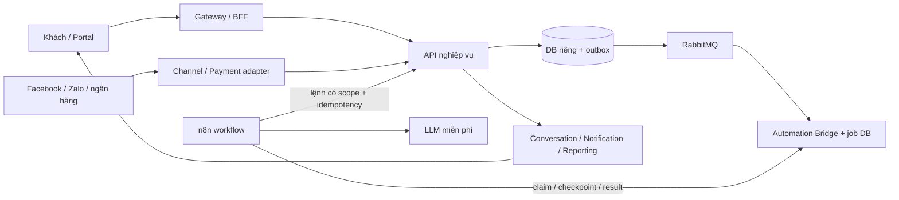

# SpaceX Agent Hub — Product Plan v3: n8n điều phối nghiệp vụ

<!-- CURRENT_N8N_LINK -->
Hiện hành 16/11/26: **N8N-05 ACCEPT_LOCAL** — WF04–07 tổng hợp local, 49/49 nhóm tích hợp cuối và affected regressions đạt. [Matrix](acceptance-n8n-05.md), [evidence index](../workflows/n8n/registration-evidence.json), [bàn giao](ban-giao-n8n-05.md). **N8N03/04 ACCEPT local** giữ theo [hồ sơ lịch sử](acceptance-n8n-03-04.md). Canonical inactive; provider/live/production và WF08–12 vẫn đóng. Các snapshot có ngày bên dưới giữ quyết định tại thời điểm ghi; các ticket cha không được coi hoàn tất chỉ từ lát cắt N8N05.

Lịch sử kiểm chứng đến 11/11/2026 — giữ nguyên receipts và quyết định cũ

## Sửa VI-02 và benchmark mới — 11/11/2026 03:49 (+07:00)

**Codex chấp nhận phần sửa policy/version đã kiểm synthetic; toàn N8N-04 vẫn
PARTIAL / NOT_ACCEPTED, model pilot NO_GO, khách thật BLOCKED.** Người dùng đã
cấp quyền đọc quota/generation metadata, xử lý Docker và nghiệm thu; grant mới
prior22/max18/trần40/0USD, retry/probe/fallback0. Engine29.1.3 đang sẵn sàng,
không cần agent bật Desktop. Không thay provider/model hoặc deadline.

Sửa generator/Draft để câu trả lời có từ về giá/chính sách/tiền tệ kèm footer
phiên bản lấy trực tiếp từ tên và policyVersion của khóa/gói trong Sources.
Nguồn thiếu/sai kiểu version hoặc tên thì TOOL_ERROR/HUMAN, không bịa version.
Giữ giới hạn4000ký tự, kiểm chữ Han, budget, policy recheck, lease/fence/CAS.
Runner ghi rõ sourcePolicyFooterAdded; không coi footer nguồn là lời do model sinh.
Đây là phần hiển thị metadata nguồn, chưa phải bộ kiểm toàn bộ sự thật của prose.

**Kiểm mới61/61 offline,14/14 n8n/DB,4/4 transport PASS trên checksum mới.**
14ca native giữ tên cũ; fixture success nay cố ý trả giá không kèm version, seed
khóa/gói Catalog thật trong DB test và đối chiếu footer đã lưu.23fixture HTTP,
0provider/key thật trong các tests. Một lượt integration đầu dừng trước begin,
0request/0key thật; nguyên nhân ban đầu chưa chứng minh, giữ receipt FAIL.
Bốn lượt mới dùng grant/project riêng cùng thêm log route/status chẩn đoán; không
đổi canonical/guard và đều PASS. Bốn loopback calls không cộng vào provider thật.

**Benchmark thật mới:1 PASS /1 FAIL /8 SKIP sau review.** VI-01 PASS bằng template,
0model. Planner VI-02 trả cùng lúc read_catalog_classes và request_handoff,
mỗi arguments={}; guard yêu cầu đúng1call nên dừng REQUEST_OR_RESPONSE_DENIED.
HTTP200/JSON/body hoàn chỉnh ở~1346ms,696token(669prompt+27completion),reasoning0,
usage.cost0; đây là lỗi tương thích contract, không phải timeout của request này.
VI-02 HUMAN/MODEL_ERROR một lần,0AI; không gọi các domain tool hoặc Model answer.
Vì vậy phần trả lời giá/policy mới chưa được quan sát với model thật. VI-03–10
SKIP sau stop; không ghép kết quả checksum cũ vào lượt mới.

**1request mới/23tích lũy/trần40**, còn17 nhưng không resume/retry sau guard stop.
Quota tài khoản là bộ đếm khác:trước31/50,sau30/50request còn lại trong ngày UTC.
Bảy GET metadata được cho phép ghi riêng,0inference; không gọi credits API hoặc
bật billing. Metadata generation xác nhận NVIDIA,tool_calls,latency598ms,
generation_time605ms,total_cost0. actualCostUsd toàn lịch sử vẫn null vì các call
dở dang cũ chưa đối soát. VI-03 timeout cũ chưa có generation ID để tra; không
suy ngược nguyên nhân nội bộ queue/generation/network từ call mới.

WF-02 SHA-256: d014806515de18917934312a3fc0be25ea002ca291197d88abff29bb2d2ab953.
Manifest: 30c10e539f1bbcbc6a1f964a104c5561aeee68422605a5bef48a740dae551cc7.
WF-01/WF-03/corpus không đổi;65source được bind,8source artifacts thay đổi.
Cleanup7project mới:0container/network,36APIport đóng,giữ28volumes;61job/execution
refs được giữ. ACL15thư mục mới/460items kiểm không còn quyền broad-user; có cảnh
báo privilege khi set lại session root vốn đã restricted, kiểm trạng thái sau đó
PASS. Không sửa ACL/key/runtime cũ,không activate/deploy hoặc xóa volume/prune.

Blocker tiếp theo: contract API required cho phép ít nhất1tool, application chỉ
nhận1hành động. Metadata model/endpoint chưa liệt kê parallel_tool_calls; đó chưa
phải bằng chứng không hỗ trợ, cũng chưa đủ để tự bật cờ rồi khẳng định có hiệu lực.
Cần chốt đường single-action được endpoint hỗ trợ và kiểm caller/guard/workflow
trước một grant mới trong quota đã cấp; giữ guard từ chối action set mơ hồ.
[Đặc tả tool calling OpenRouter](https://openrouter.ai/blog/tutorials/tool-calling/).

Evidence mới: **policyVersionFixAuthorizedBenchmark20261111** trong
[index](../workflows/n8n/chat-hardening-evidence.json);
[review](../.local/automation/n8n04-policy-fix-20261111-3be3a660093a/quality-review.json), [chẩn đoán](../.local/automation/n8n04-policy-fix-20261111-3be3a660093a/diagnosis.json),
[metadata](../.local/automation/n8n04-policy-fix-20261111-3be3a660093a/live-metadata.json), [verification](../.local/automation/n8n04-policy-fix-20261111-3be3a660093a/verification.json).
Các mục bên dưới là lịch sử. Ngưỡng50hội thoại gán nhãn, dữ liệu/egress/consent,
người trực HUMAN và production/load/restore/SLA vẫn là gate riêng chưa đạt.

## Benchmark thật hiện hành — 11/11/2026 03:06–03:07 (+07:00)

**N8N-04 vẫn NOT_ACCEPTED / PARTIAL, model pilot NO_GO, khách thật BLOCKED.**
Người dùng chọn dùng quota còn lại: grant mới prior18/max5/tổng23, không cấp đề xuất
nâng trần36. Docker Engine đã sẵn sàng khi preflight kiểm lại; agent không bật Desktop.
Đã chạy model thật trên WF-02 checksum **69476ff9…ef3ed1e44**: sau review
**1 PASS / 2 FAIL / 7 SKIP**. VI-01 PASS bằng clarification template, 0 model request;
VI-02 FAIL vì câu trả lời bỏ policy/version dù giá và nguồn đúng; VI-03 FAIL body
timeout sau HTTP200. Không dùng DONE/HTTP200/handoff an toàn thay nội dung đạt.

**4 request mới / 22 tích lũy / trần23**, còn1 nhưng không retry/probe/tiếp tục sau
guard stop. Ba usage reports:2.285 prompt +230 completion =2.515 token, reasoning0,
reported subtotal0USD. Call4 thiếu usage nên costUsd=null/costUnknown=true;
**actualCostUsd=null**, không gọi account/billing API để đối soát.

Instrumentation thật của VI-03: headers200 ở580ms, byte đầu582ms, byte cuối3526ms,
**22byte/2chunk**, body chưa hoàn tất ở5916ms, guard ghi5919ms. Không lưu partial
body; chưa biết22byte là gì, không suy ra inference/token/keepalive/queue/generation.
Nguyên nhân nội bộ provider và nguyên nhân các attempt cũ vẫn chưa chứng minh.
Giữ deadline5900/node8000 và không đổi model/provider để ép PASS.

Giữ kết quả **58/58 offline,14/14 native,4/4 transport** của source không đổi ngày
10/11; không gắn nhãn chạy mới. Đã kiểm lại **65/65 hash source,706 refs lịch sử**.
Lượt mới có fresh isolated DB/role/seed, inactive fixtures,7 job/execution refs,
3 hội thoại/3GUEST/2AI DELIVERED/1HUMAN TIMEOUT; replay409 và dedup đúng cả3.
Cleanup project mới:0container/network,5API port đóng,giữ4volume. ACL hai thư mục
mới đã siết về owner/process account,Administrators,SYSTEM và kiểm62items; không
đổi ACL/key/dữ liệu runtime cũ. Workflow exports được kiểm hash; không coi đó là
diễn tập restore DB/key, không activate/deploy hoặc ký thay con người.

Checklist và thứ tự xử lý tiếp: [đóng N8N-04](checklist-dong-n8n-04.md).
Evidence mới **availableBudgetLiveCloseout20261111** trong
[index](../workflows/n8n/chat-hardening-evidence.json);
[review từng ca](../.local/automation/n8n04-closeout-20261111-653595913f6f/quality-review.json),
[chẩn đoán](../.local/automation/n8n04-closeout-20261111-653595913f6f/diagnosis.json),
[verification](../.local/automation/n8n04-closeout-20261111-653595913f6f/verification.json).
Các mục ngày10/11 bên dưới giữ nguyên làm lịch sử; không thay kết quả lượt mới.

## VI-01 và instrumentation — 10/11/2026 (+07:00), trạng thái hiện hành

**Đã nghiệm thu kỹ thuật VI-01 template + instrumentation synthetic theo ủy quyền
cho Codex; N8N-04 vẫn PARTIAL / NOT_ACCEPTED, model pilot NO_GO, khách thật BLOCKED.**
WF-02 hỏi đúng hai câu mục tiêu/thời gian học khi GUEST ở lượt đầu nói rõ chưa biết
học gì, không gọi model hay đề xuất khóa/giá. Matcher chỉ bao phủ sự lưỡng lự rõ
ràng ở lượt đầu; giữ readiness/policy, source đọc Catalog/Class, recheck và backend
contract. Runner ghi `CLARIFICATION_TEMPLATE`, model inference=false, không tự
đánh dấu thành benchmark model PASS.

Guard có số đo headers/byte đầu-cuối/số byte-chunk/body complete/thời gian đọc và
khoảng im lặng cuối body, không lưu body dở dang. Đây là thời gian quan sát Fetch
ở client, chưa xác định queue/generation/network phía provider. Deadline/cap giữ
nguyên. **58/58 offline, 14/14 native (13 cũ + 1 mới), 4/4 transport integration**
PASS: trước headers, trước byte đầu, treo sau 9 byte và n8n kết thúc trước guard.
Receipt FAIL do cạnh workflow trùng lúc phát triển được giữ; generator đã sửa và
có regression check. Guard cuối có checks riêng sau lần native, canonical/harness
không đổi.

WF-02 mới `69476ff95cbdbe26520002db381fd51291b4caf6545e5ba912c93dcef3ed1e44`;
manifest `eddb8150c5c4144187bc25b46b0cd14883d360118a6b8b425141c652d0b19352`.
WF-01/WF-03/corpus không đổi. **0 provider request thật, không đọc key; vẫn 18/23,
còn 5**. Bốn loopback requests không cộng vào tổng thật. Benchmark thật gần nhất
**1 PASS / 2 FAIL / 7 SKIP thuộc checksum cũ**; chưa có model benchmark trên bản mới,
chưa chứng minh timeout thật đã hết, actualCostUsd lịch sử vẫn null. Muốn chạy tiếp
cần grant mới bind checksum/history hiện hành trong quota còn lại; không tái dùng
grant đã dừng, không tự tăng quota hoặc đóng N8N-04.

Cleanup 6 project mới: 0 container/network, 32 cổng đóng, giữ 24 volumes; không
activate/deploy/sửa runtime cũ. 445 refs lịch sử giữ nguyên. Xem
[bàn giao hiện hành](ban-giao-n8n-04.md), [review](review-n8n-04-hardening.md) và
[verification](../.local/automation/n8n04-clarification-instrumentation-20261110-13ca6d43f755/verification.json). Các kết quả bên dưới là lịch sử, không phải kết quả
model cho checksum mới; các production gates vẫn chưa hoàn tất.

**N8N-04 mới nhất 10/11/2026 14:55 (+07:00), quyết định theo ủy quyền cho Codex:**
Chấp nhận phần kỹ thuật synthetic:53/53 offline, 13/13 canonical runtime, 3/3 transport mới.
Runner cộng history, WF-02 checksum mới 94a7c999…c84c1c tắt reasoning/ép0 USD/kiểm ngôn ngữ,
node 8 s có margin cho guard 5, 9 s. Benchmark thật **1 PASS/2 FAIL/7 SKIP**, 6 request mới/
18 tích lũy;VI-01 lỗi nội dung, VI-02 PASS, VI-03body timeout.5 usage báo reasoning 0,
subtotal 0 USD nhưng actualCostUsd=null. **NOT ACCEPTED toàn N8N-04 / NO-GO model pilot /
khách thật BLOCKED**, không chờ hoặc giả lập chữ ký con người. [Hồ sơ](ban-giao-n8n-04.md),
evidence `delegatedReasoningTimeoutFix20261110`. Bảng ticket vẫn PARTIAL; các khối dưới
là lịch sử, checksum/benchmark cũ không thay thế kết quả mới.

**N8N-04 mới nhất 10/11/2026 13:46 (+07:00), ưu tiên hơn snapshot bên dưới:**
Engine đã sẵn sàng; integration admission mới 1/1 PASS (1 loopback, 0 provider), rồi lượt
benchmark thật dùng **9 request mới/12 tích lũy**, dừng ở VI-05planner headers 200/body timeout.
Review **2 PASS / 1 FAIL / 2 NEEDS_REVIEW / 5 SKIP**: VI-03/04 PASS; VI-01 ngôn ngữ, VI-02 visible
policy version còn review; VI-05 không có final response; VI-06–10 SKIP.8 usage/8.544 token,
reported subtotal 0, actualCostUsd=null. Timeout/checksum không đổi;13/13synthetic,
43/43offline, 9/9caller, 3/3transport là lịch sử giữ nguyên. **PARTIAL / NO-GO pilot có model**,
chưa ký/chấp nhận pilot, khách thật BLOCKED. [Checklist/evidence](ban-giao-n8n-04.md),
`engineReadyBudget23Benchmark20261110`. Lượt sau phải bind đủ12 attempt trước quyền mới;
không tự dùng11 request còn lại sau stop. Bảng ticket phía dưới giữ trạng thái PARTIAL và snapshot lịch sử.

**N8N-04 cập nhật tiếp tục 10/11/2026 (+07:00), ưu tiên hơn snapshot bên dưới:**
quyền mới prior3/max20/total23 đã ghi; runner bind đủ ba attempt, 9/9 kiểm caller mới đạt.
Engine chưa sẵn sàng → lượt mới **0 PASS / 0 FAIL / 10 SKIP**, 0 provider, không đọc key
hay tạo runtime. Benchmark thật gần nhất tại `confirmedBudgetIntegrationBenchmark20261110`
vẫn **0 PASS / 1 FAIL / 9 SKIP**, 2 request lượt đó / 3 tích lũy; planner844token/cost0,
answer headers200/body timeout, actualCostUsd=null. Synthetic13/13, offline43/43,
transport integration3/3 giữ lịch sử; chưa chạy runtime admission mới. Timeout/checksum
không đổi. Ticket PARTIAL; **NO-GO pilot có model**, người chính chưa ký, pilot chưa
được chấp nhận, khách thật BLOCKED. [Hồ sơ quyết định](ban-giao-n8n-04.md), evidence mới
`continuationBudget23EngineSkip20261110`. Các khối bên dưới giữ làm lịch sử.

**N8N-04 mới nhất 10/11/2026 (+07:00):** sau quyền provider rõ, benchmark checksum cuối
dừng theo guard ở VI-01: **0 PASS / 1 FAIL / 9 SKIP**, 1 request attempt, không có model
response/usage được xác nhận; không retry. Synthetic acceptance 13/13 vẫn giữ nguyên.
Benchmark chưa đạt, người chính chưa ký, pilot chưa được chấp nhận, rollout khách BLOCKED.
[Kết quả/biên bản](ban-giao-n8n-04.md), evidence `finalChecksumAuthorizedBenchmark20261110`;
các khối cập nhật trước bên dưới giữ làm lịch sử.

### Trạng thái N8N-04 hiện hành — 10/11/2026 (+07:00)

**PARTIAL / LOCAL synthetic acceptance đạt; chưa đóng N8N-04.** Review độc lập sau
runtime xác nhận **13 PASS / 0 FAIL / 0 SKIP** trên checksum WF-02 cuối
`885d4f6e35103bc177c96f7de3938b42b1adae63f02b43a29ee675c0fab98068`, manifest
`1096403f14f46e88bb215e9b3a21f7369654912989b4074b99c3f0fb6ec6749a`.
Evidence: `focusedChecksumAcceptanceRuntime20261110` trong
[receipt index gốc](../workflows/n8n/chat-hardening-evidence.json);
[review độc lập](review-n8n-04-hardening.md), [bàn giao/checklist quyết định](ban-giao-n8n-04.md).
Đã đối chiếu hash source/harness/receipt/fixture/diff và 34 trace; runtime có
23 fixture requests (12 planner / 10 answer / 1 tool), 0 provider,
13 hội thoại / 5 AI DELIVERED / 8 HUMAN, 34 job/execution refs. `modelInference:false`.

**Benchmark model thật trên checksum cuối chưa đạt/chưa chạy**; 10/10 ngày 09/11 là
lịch sử checksum trước hardening cuối. Người chính chưa ký (`humanReviewPending:true`),
**pilot chưa được chấp nhận** (`pilotAccepted:false`), rollout khách BLOCKED.
Cần phê duyệt corpus/ACL/retention, provider nếu có inference, benchmark cuối,
version/checksum/drain/recovery và quyết định người chính theo checklist bàn giao.
Khách thật cần thay đổi riêng cùng các gate dữ liệu/egress/load/restore/SLA; không
được mở chỉ bằng đổi env. Không mở thêm Enrollment/Payment, kênh ngoài hoặc WF-04–12.

Lượt review này chỉ kiểm artifact/source và cập nhật tài liệu; không chạy lại acceptance,
Bridge/IAM/browser/regression cho source không đổi. Các mục Actual/Snapshot 08–09/11
và kết quả model local bên dưới giữ làm lịch sử; trạng thái hiện hành ở đây có ưu tiên.

Cập nhật: **04/11/2026**, múi giờ Asia/Ho_Chi_Minh. Đây là kế hoạch đồ án đã chốt hướng triển khai với người làm chính, chưa phải nghiệm thu chức năng hoặc phê duyệt production của customer.

Tài liệu này thay thế định hướng kiến trúc, lịch và phân công v2. Đi cùng [phân công v3](phan-cong-task-v3.md) và [đặc tả workflow](n8n-workflows.md). Giữ G1–G11, 86 mã ticket và C01–C12 để truy vết; các quy tắc chi tiết về trạng thái, tiền, quyền lợi, riêng tư và định nghĩa chỉ số tại [v2, mục 4–8](product-plan-v2.md#4-mô-hình-dữ-liệu-và-quyền-sở-hữu) tiếp tục là baseline trừ thay đổi được nêu rõ dưới đây. Không kế thừa mô tả hiện trạng, thứ tự làm việc hoặc lựa chọn provider cũ như trạng thái live.

## 1. Kết quả cần đạt và hiện trạng

### 1.1 Cam kết lập kế hoạch

| Nội dung | Quyết định |
| --- | --- |
| Báo cáo lần 1 | **Thứ Tư 11/11/2026**: web chat → n8n → AI gọi Catalog/Class thật → trả lời; nhân viên tiếp quản; trình diễn một nhánh lỗi |
| Final | **05/01/2027**: bao phủ M0–M4, mỗi chức năng có demo chạy được và bằng chứng chạy lại; không coi đây là sẵn sàng production |
| Nhân lực | Một người chính trên 35 giờ/tuần; hai người hỗ trợ không thường xuyên, không nằm trên đường găng |
| n8n | Giảng viên yêu cầu workflow n8n: phải có JSON import được, sơ đồ node, execution và kết quả nghiệp vụ |
| AI | API miễn phí trước; không bật billing, không tự đổi sang trả phí; AI local chỉ là phương án dự phòng sau benchmark |
| Hạ tầng | VPS và domain tổng quy đổi **≤ 500.000đ/tháng**; chưa có VPS; dự toán phải ghi cả tiền trả trước và thuế/phí |
| Kênh | Web chat trước; Facebook rồi Zalo; cả Facebook/Zalo là mục tiêu final, hiện chưa có quyền API |
| Thanh toán | Khảo sát SePay trước, chưa có provider; tài khoản ngân hàng do thành viên sở hữu, giao dịch thử nhỏ và có bằng chứng |
| Thông báo | Portal + email; chat chỉ gửi khi adapter xác nhận đủ điều kiện/cửa sổ/consent |
| Quyền AI | Tư vấn và yêu cầu đơn/hold/QR sau xác nhận rõ của khách; người duyệt hoàn tiền, ngoại lệ và thay đổi quyền lợi |

M0 là nền tảng, M1 là vận hành tuyển sinh, M2 là AI và kênh ngoài, M3 là mở rộng, M4 là Student Portal. Tên mốc được giữ để truy vết nhưng thứ tự thay đổi: một lát cắt AI chỉ đọc được kéo lên báo cáo lần 1; tạo đơn bằng AI chỉ bật sau khi kiểm chứng Enrollment/Payment.

Final giữ cả waitlist, bảo lưu, chuyển lớp, học bù, hóa đơn mô phỏng, import, reporting, xóa/retention và Student Portal. Các tích hợp có điều kiện trong v2 như Instagram/TikTok, thu thủ công và import không bị xóa khỏi danh mục; phải demo phần API/workflow tương ứng hoặc ghi rõ BLOCKED/chưa đạt nếu quyền/chính sách chưa được cấp. Adapter mô phỏng có nhãn chỉ là diễn tập, không được tính thành kênh thật. Không tự hạ phạm vi vì trễ lịch.

LMS, điểm/chứng chỉ, kế toán thuế, hóa đơn điện tử pháp lý, trả góp tự động và bundle nhiều khóa vẫn ngoài phạm vi như v2. Tiêu chí demo nhẹ hơn vận hành production về tải/SLA, không giảm yêu cầu không bán trùng, không nhân đôi tiền, kiểm quyền và không xác nhận sai.

### 1.2 Snapshot bằng chứng ngày 04/11

Đã có code IAM/Org/Gateway/Portal, Catalog, Class/hold/giờ rảnh và CRM; n8n local và smoke kỹ thuật N8N-01 đã triển khai, xem [bằng chứng thực tế](ban-giao-n8n-01.md). N8N-02 Bridge đã đạt acceptance kỹ thuật LOCAL: 11 integration tests và smoke n8n claim/checkpoint/result thật, xem [bàn giao N8N-02](ban-giao-n8n-02.md). N8N-03 đã kiểm chứng LOCAL authority IAM/delegation/revocation và đọc Catalog/Class: 12/12 ca, chạy lại 11/11 N8N-02 và hai smoke n8n thật, xem [bàn giao N8N-03](ban-giao-n8n-03.md). Ticket tổng giữ PARTIAL vì confirmation/approval/command còn phụ thuộc service nguồn; chưa bật workflow nghiệp vụ. Chưa có Channel/Conversation, Enrollment/Payment/Notification nghiệp vụ hoàn chỉnh. Nền messaging chưa được nghiệm thu xuyên toàn hệ thống nghiệp vụ.

Các mã bằng chứng dưới đây dùng trong bảng ticket; đây là **bàn giao lịch sử**, chưa chạy lại ở lượt sửa plan:

- **E1**: [bàn giao đợt 1](ban-giao-dot-1.md), IAM/Org/Gateway/Portal.
- **E2**: [bàn giao lớp/hold](ban-giao-lop-giu-cho.md), Class/Catalog PostgreSQL và kiểm cạnh tranh chỗ.
- **E3**: [bàn giao vòng 2](ban-giao-vong-2-2026-11-03.md), reliability, policy, giờ rảnh, vòng đời; các suite tích hợp và browser local.
- **E4**: [bàn giao CRM](ban-giao-crm-2026-11-03.md), 56/56 tác vụ workspace và 10/10 CRM DB theo tài liệu, chưa phải CI remote.
- **E0**: chưa có bằng chứng nghiệp vụ thật được ghi nhận. Trang mock/localStorage không phải bằng chứng.

### Actual bổ sung 08/11 — N8N-04

Actual 09/11: **N8N-04 LOCAL — chỉ đọc**, model free thật gọi Catalog/Class qua n8n,
benchmark **10/10 local** được Codex đối chiếu; xem [bàn giao/evidence](ban-giao-n8n-04.md).
Chưa activation/production; người chính còn review. Gate key đã được gỡ, các ticket
AG/CV/Channel rộng hơn vẫn PARTIAL vì ngoài lát cắt web chỉ đọc còn backlog.

Snapshot 08/11: **N8N-04 PARTIAL**: đã có lát cắt Channel/Conversation/web chat/hộp thư và workflow
WF-01/02/03; kiểm chứng local kỹ thuật và blocker tại [bàn giao](ban-giao-n8n-04.md).
Người dùng chưa cấp key model: chưa có AI live/benchmark 10 ca, không đóng N8N-04.
Receipt N8N-02/03 lịch sử không thay cho kết quả regression mới trong bàn giao này.

## 2. Kiến trúc và hợp đồng tích hợp

### 2.1 Quyền sở hữu

Giữ 13 ranh giới service của v2; thay service AI Agent dự kiến bằng **Automation Bridge**. n8n là runtime điều phối ngoài các service, có DB riêng. Chỉ dựng service khi có ticket; không viết lại service đã có.

| Thành phần | Sở hữu | Không giao cho thành phần này |
| --- | --- | --- |
| IAM/Org/Gateway | Tài khoản, phiên, quyền/scope, tổ chức, định tuyến | Quyết định nghiệp vụ Enrollment hoặc job |
| Channel/Conversation | Xác thực webhook/phiên chat, tin bền vững, delivery, owner/mode/version | LLM tự gửi trực tiếp hoặc tự cấp quyền |
| CRM/Catalog/Class | Hồ sơ/consent; giá/policy/quote; lớp/lịch và thao tác chỗ nguyên tử | Đọc/ghi DB service khác |
| Enrollment/Payment | State machine/snapshot/quyền lợi/phê duyệt; ledger/QR/webhook/đối soát | Saga điều phối chạy song song với n8n |
| n8n | LLM/tool calling, rẽ nhánh, gọi API, điều phối bù trừ, cron, theo dõi bước | Ghi SQL nghiệp vụ, giữ số chỗ/tiền duy nhất trong execution, tự duyệt |
| Automation Bridge | Inbox/event, job, lease, attempt, checkpoint kỹ thuật, workflow version, recovery | Giá, tiền, quyền lợi, trạng thái đơn gốc |
| Notification/Reporting | Intent/delivery; read model/checkpoint/audit | Xác nhận đăng ký từ sự kiện nhận tiền đơn thuần |
| Portal/Student Portal | Form, xác nhận, phê duyệt, dữ liệu theo ownership | Token n8n hoặc quyền do frontend tự khai |

Enrollment cung cấp chuyển trạng thái hợp lệ và lưu tiến trình nghiệp vụ. n8n là bên duy nhất chọn bước điều phối kế tiếp. Bridge khôi phục job n8n và tra operation cũ; worker timeout của Class/Payment chỉ bảo vệ tài nguyên/trạng thái riêng rồi phát event. Không thêm backend worker tự chạy lại toàn saga Enrollment.

### 2.2 Hợp đồng mới cần triển khai

**Bridge endpoints bên dưới đã có trong N8N-02 LOCAL**, contract/runbook tại [Automation Bridge](../services/automation-bridge/README.md); API command/operation của service nguồn vẫn là phần cần triển khai. Đặc tả đầy đủ về job nằm tại [workflow, mục 2](n8n-workflows.md#2-hợp-đồng-job-và-quy-tắc-thực-thi). Bridge chỉ mở nội bộ, chưa đưa replay hoặc internal API vào Gateway:

| Interface | Hành vi tối thiểu |
| --- | --- |
| `POST /internal/automation/jobs/claim` | Claim nguyên tử job phù hợp workflow/version; trả lease và tham chiếu payload đã che |
| `POST /internal/automation/jobs/:id/checkpoint` | CAS theo lease/attempt, lưu bước, operationId, kết quả/thời điểm; từ chối worker cũ |
| `POST /internal/automation/jobs/:id/result` | DONE/WAITING/RETRY/DEAD; WAITING có loại event/thời hạn; không ghi đè job đã kết thúc |
| `GET /internal/automation/jobs/:id` | Tra cứu theo scope của service/operator; không công khai payload nhạy cảm |
| `POST /api/v1/automation/jobs/:id/replay` | Center director, lý do bắt buộc, audit; giữ ID và operation key, kiểm lại quyền trước chạy |
| API lệnh từng service + `GET /api/v1/operations/:id` tại service chủ | Idempotency-Key, operationId, version; cùng key khác payload bị chặn; tra sau timeout trước khi thử lại |

Endpoint operations có sẵn ở Class là danh sách/replay messaging, **không phải** API tra command trên. Khi triển khai phải tách rõ hợp đồng và route, không thay ngầm semantics route cũ. API hiện hữu vẫn qua Gateway/BFF; không đưa Bridge nội bộ vào catch-all public.

Giữ EventEnvelope hiện có (`id`, `type`, `version`, `occurredAt`, `correlationId`, `payload`); `eventId` của job ánh xạ từ `id`, `version` hiện là schema version. Mở rộng có version tương thích để thêm `causationId`, `entityId`, `entityVersion`; không nhầm aggregate version với schema version. Consumer cũ vẫn đọc được envelope cũ trong thời gian chuyển đổi.

IAM phải cấp machine principal giới hạn audience/scope và kiểm phiên. Bridge ghi ngữ cảnh khởi tạo từ backend đã xác minh; backend đích tra lại quyền hiện hành, branch/ownership, confirmation/approval. Job hệ thống dùng policy/service actor đã khai báo. Không chuyển access token dài hạn của người dùng, không tin `actorId`/role do node hoặc LLM tự gửi, không cấp token center_director chung cho n8n.

### 2.3 Các luồng chuẩn

1. **Tư vấn:** Channel lưu/dedup → event → WF-01 tạo/định tuyến Conversation → WF-02 đọc context đã che → tools Catalog/Class → Conversation kiểm mode/version → outbox gửi đúng Channel. WF-03 đổi owner/version nguyên tử khi tiếp quản; AI cũ bị loại.
2. **Đăng ký:** xác nhận khách lưu ở backend → WF-05 tạo Enrollment snapshot → Class hold → Payment tạo QR. Có `payment.matched` thì WF-06 yêu cầu commit → Enrollment CONFIRMED → `enrollment.confirmed` → WF-10/CRM/Reporting. Không gửi xác nhận chỉ từ `payment.matched`.
3. **Ngoại lệ:** WF-07 tra trạng thái gốc và xử lý tiền muộn/thiếu/thừa/hết hạn. Không còn chỗ thì đưa người quyết định hoàn/chuyển; không tự gia hạn hold hoặc tự gán giao dịch sai mã.
4. **Thay đổi quyền lợi:** WF-08/09 đọc phê duyệt/version, gọi API, giữ quyền lợi cũ khi thao tác mới chưa chắc chắn, yêu cầu bù trừ có idempotency; WF-10 thông báo theo phiên bản cuối.

## 3. Chính sách, hạ tầng và dependency

### 3.1 C01–C12 và mặc định đồ án

Giữ người duyệt và nội dung C01–C12 ở v2; bảng sau ghi thay đổi/điểm phải khóa. Người chính là người theo dõi; chưa tự ký thay customer hoặc giảng viên. Mỗi quyết định cần người quyết định, ngày, version và bằng chứng. Với demo giả lập trung tâm, người chính ghi rõ chính sách DEMO; giao dịch ngân hàng thật vẫn cần chủ tài khoản đồng ý và đối chiếu.

| Mã | Áp dụng v3 / điều kiện còn mở | Hạn kiểm tra |
| --- | --- | --- |
| C01 | Đồ án, một chi nhánh demo, quyền hỗ trợ đủ đơn vị; G1–G11 giữ nguyên | 10/11 |
| C02 | Lớp OPEN đủ lịch/phòng/giảng viên; chốt sĩ số/hoãn/học bù trước mở bán tương ứng | 25/11 |
| C03 | Đề xuất hold 20 phút, REVIEW tối đa 24h một lần; thời hạn server, không để cron n8n quyết định chỗ hết hạn | 25/11 |
| C04 | QR trả đủ qua SePay nếu kết nối được; thu thủ công/chứng từ là workflow riêng cần quyền và phê duyệt | 10/11 khảo sát; 25/11 khóa |
| C05 | Hoàn/chuyển/bảo lưu cần quy tắc version, hạn, chênh lệch và người duyệt; không công bố tính năng chưa làm | 25/11 |
| C06 | Demo giờ trực 08:00–20:00, hạn nhận đề xuất 5 phút; queue/handoff trước, AI có công tắc tắt | 10/11 |
| C07 | Tách contact/learner/payer, quan hệ đại diện phải xác minh; không tự merge | 25/11 |
| C08 | Giá chung, ghi riêng branch học/nguồn/đơn vị nhận tiền; không gọi thu ròng là lợi nhuận | 25/11 |
| C09 | Dữ liệu khách demo tổng hợp; che PII trước LLM/log; retention và ngoại lệ giữ chứng từ được ghi rõ | 10/11 tối thiểu; 23/12 đầy đủ |
| C10 | Thay payOS sandbox mặc định bằng khảo sát SePay; Facebook rồi Zalo, chưa có quyền; IG/TikTok có điều kiện | 10/11 gate đầu tiên |
| C11 | API AI 0đ, VPS+domain ≤500.000đ/tháng; quota thực tế, benchmark và chi phí trả trước | 10/11 |
| C12 | Import fixture có nhãn qua API mỗi service, dry-run và đối chiếu; không giả giao dịch ngân hàng mới | 23/12 |

### 3.2 Yêu cầu triển khai n8n

- Community self-host bằng Docker, PostgreSQL DB/user riêng; ghim image version sau smoke import/node tương thích, không dùng `latest` trong bản bàn giao. Một instance trước, chưa dùng queue mode khi chưa đo thấy nhu cầu.
- Local phục vụ phát triển; VPS là môi trường tích hợp/demo public. Reverse proxy HTTPS cho BFF/webhook, editor n8n chỉ người vận hành; DB/RabbitMQ/Bridge nội bộ không public. Local dùng compose override riêng, không chép đè `.env` hay đổi cổng DB đang dùng.
- `N8N_ENCRYPTION_KEY` cố định và backup riêng khỏi repo; giữ volume, DB và cấu hình. JSON workflow có thể chứa credential reference, không chứa token/password hoặc execution payload thật. Không dựa vào tính năng Git/environments trả phí: export/import JSON có review.
- Mặc định thiết kế: tối đa 2 execution nghiệp vụ đồng thời; claim theo workflow mỗi 5 giây nếu còn slot, không tích lũy execution poll đang chạy khi hết slot. Node HTTP 10 giây, LLM tổng 20 giây/turn và tối đa 4 tool calls; timeout chuyển trạng thái chờ/handoff. Các số này là cấu hình dự kiến, phải đo trước nghiệm thu.
- Execution data đã che: giữ tối đa 7 ngày, dọn hằng ngày; bằng chứng final chọn lọc, che PII và lưu riêng. Deadline nghiệp vụ/checkpoint/receipt ở backend/Bridge không bị mất theo execution pruning.
- Retry kỹ thuật tối đa 8 attempt, exponential backoff 2 giây đến trần 300 giây; theo Retry-After khi provider yêu cầu. Một tầng Bridge quyết định lịch retry, không để cả node và Bridge nhân số lần. Validation/quyền/schema sai không retry mù. Human wait không tiêu attempt, có hạn và người nhận.
- Backup DB hằng ngày và trước migration, backup encryption key/config/workflow. Restore vào instance biệt lập, kiểm credential và money/seat reconciliation trước bật nhận đơn mới. Mục tiêu đề xuất RPO 24h/RTO 4h cần kết quả diễn tập, không coi là SLA đã đạt.

### 3.3 Gate tích hợp, AI và ngân sách

Ngày **10/11** phải có biên bản: quyền/app Facebook/Zalo, điều kiện ngân hàng/SePay, model free tier/quota, SMTP thử, VPS/domain và người phụ trách. Thiếu quyền là BLOCKED, không thay bằng tuyên bố đã tích hợp. Lần 1 vẫn dùng web chat chạy thật; video chỉ hỗ trợ trình bày, không thay nghiệm thu live.

AI khảo sát Gemini free tier trước: đo 10 ca tiếng Việt/JSON tool ở local bằng tài khoản nhóm, ghi model ID, ngày, quota và kết quả; chọn model miễn phí vượt toàn bộ ca quyền/nguồn/handoff. Nếu không có model đạt thì báo blocker, dùng người trả lời, không gọi đó là AI thật. Mở rộng tối thiểu 50 hội thoại gán nhãn trước auto-send final; 100% số liệu giá/lịch/chỗ có nguồn, 100% ca vượt quyền bị chặn, tối thiểu 90% đề xuất phù hợp nhãn. Không gửi tên/điện thoại/sao kê thực lên free API. RTX 3050 laptop 4GB hiện có chỉ là ứng viên Ollama, chưa benchmark, chưa hứa fallback tự động.

SePay là ứng viên, chưa mặc định miễn phí hoặc ngân hàng đã tương thích. Thử sandbox/test mode trước, rồi webhook/giao dịch thật nhỏ do chủ tài khoản cho phép. Payment phải xác thực webhook theo hợp đồng provider, lưu giao dịch bền và dedup theo provider/account/transactionId. QR tĩnh tự tạo không chứng minh đã nhận tiền. Hoàn demo thực hiện thủ công có kiểm soát, mã bằng chứng và đối chiếu.

Dự toán hạ tầng là **trần lập kế hoạch, chưa phải báo giá**: VPS ≤400.000đ/tháng, domain quy đổi ≤50.000đ/tháng, dự phòng ≤50.000đ/tháng, tổng gồm thuế/phí ≤500.000đ/tháng. Ghi tổng tiền trả trước domain theo năm và VPS theo kỳ; không mua trước khi xác nhận khoản trả trước. Khảo sát VPS khởi điểm 2 vCPU/4GB RAM, đo stack trước khi chọn; build image ngoài VPS nếu cần. Không đủ tài nguyên/ngân sách thì ghi blocker và xin thay phương án, không tự vượt trần. Phí provider và tiền giao dịch thử là mục riêng cần ghi rõ chủ tài khoản, mức thử và tổng tiền được chấp thuận trước live.

Nguồn cần kiểm lại lúc tích hợp: [n8n self-host](https://github.com/n8n-io/n8n-hosting), [workflow export không phải migration đầy đủ](https://support.n8n.io/article/migrating-from-cloud-to-self-hosted), [Gemini quota](https://ai.google.dev/gemini-api/docs/rate-limits), [Gemini giá/free tier](https://ai.google.dev/gemini-api/docs/pricing), [SePay webhook](https://developer.sepay.vn/vi/sepay-webhooks/tao-webhook), [Zalo cấp quyền](https://oa.zalo.me/home/documents/guides/Khoi-tao-ung-dung-va-cap-quyen_117071366476220195). Không đóng ticket chỉ dựa trên tài liệu provider.

## 4. Roadmap và sổ truy vết 86 ticket

### 4.1 Mốc và điều kiện ra mốc

| Thời gian | Đầu ra có thể nghiệm thu |
| --- | --- |
| 04–10/11/2026 | Plan v3; n8n local/Bridge tối thiểu; Channel/Conversation/web chat và WF-01/02/03; script demo, log và nhánh lỗi |
| 11/11/2026 | Báo cáo lần 1: AI live/tool thật, handoff và lỗi; công bố phần chưa đạt |
| 12–25/11/2026 | VPS/HTTPS, Facebook, CRM khép với kênh, Enrollment, WF-04/05 |
| 26/11–09/12/2026 | SePay live nếu đủ điều kiện, WF-06/07, xác nhận/thông báo, race và restart |
| 10–23/12/2026 | Zalo, WF-08/09/10, Student Portal/OTP/ownership, chính sách mở rộng |
| 24–30/12/2026 | WF-11/12, import, merge/retention, hóa đơn mô phỏng, reporting/audit, restore |
| 31/12/2026–04/01/2027 | Chạy lại toàn bộ nghiệm thu, sửa lỗi, báo cáo và video dự phòng |
| 05/01/2027 | Final: từng chức năng có trạng thái/bằng chứng thật, phần thiếu ghi rõ |

Đây là lịch mục tiêu có rủi ro cao với một người chính, không phải bảo đảm toàn bộ ticket xong. Xem [phân công v3](phan-cong-task-v3.md) để biết thứ tự và gate. Không tính phần trăm hoàn thành mới từ số dòng ticket hoặc số execution.

### 4.2 Ánh xạ toàn bộ ticket cũ

Trạng thái: **LOCAL** = có bàn giao local trong phạm vi cũ, cần regression khi tích hợp v3; **PARTIAL** = đã có một phần, còn gap; **TODO** = chưa có nghiệp vụ thật/bằng chứng đủ; **COND** = phụ thuộc quyền/chính sách, chưa đạt. Đây không phải trạng thái CI remote/UAT. Cột BE/FE/WF/KT lần lượt là backend, frontend, workflow và kiểm thử bắt buộc. Dấu `—` nghĩa không cần workflow riêng, không có nghĩa bỏ ticket. U01–U20 giữ nghĩa bộ UAT v2 mục 11.2, bổ sung N01–N12 ở mục 5.

| Ticket | BE: phần sở hữu | FE: phần hiển thị/thao tác | WF | KT | Trạng thái | Bằng chứng / phần thiếu |
| --- | --- | --- | --- | --- | --- | --- |
| PL-1 | Template, CI, migration/deploy | — | — | N01, U19 | PARTIAL | E1/E3; thiếu pipeline/deploy độc lập thực chứng |
| PL-2 | Outbox/inbox, Bridge/recovery | Operations | WF-12 | U12, N03 | PARTIAL | E3; chưa tích hợp Bridge/service mới |
| PL-3 | Trace/metric/alert | Operations | WF-12 | N11 | PARTIAL | E3; chưa có vận hành xuyên luồng |
| IAM-1 | Login/hash/token | Login | — | U01 | LOCAL | E1; thêm regression v3 |
| IAM-2 | Scope/ownership, machine principal | Guard/menu | WF-01–WF-12 | U02, N04 | PARTIAL | E1; quyền người đã có, chưa có machine principal v3 |
| IAM-3 | OTP learner/ownership | Student login | WF-10 | U02, N10 | TODO | E0 |
| IAM-4 | Refresh/logout/revoke | Phiên/hết hạn | — | U01 | LOCAL | E1 |
| ORG-1 | Đơn vị/phòng ban | Tổ chức | — | U02 | LOCAL | E1 |
| ORG-2 | Nhân sự/đồng bộ IAM | Nhân sự/quyền | — | U01, U02 | LOCAL | E1; kiểm regression khi quyền đổi |
| GW-1 | JWT/routing/correlation | BFF | — | U02 | LOCAL | E1 |
| GW-2 | Rate limit/BFF | Lỗi/thử lại | — | U20, N04 | PARTIAL | E3; rate limit một instance, chưa pilot v3 |
| CH-1 | Adapter/webhook/dedup | Delivery | WF-01 | U03 | PARTIAL | N8N-04 web Channel local; adapter ngoài chưa làm |
| CH-2 | Web chat session/reconnect | Widget | WF-01 | U03, U20 | PARTIAL | N8N-04 API/DB/browser/model local; chưa rollout khách thật |
| CH-3 | Zalo adapter/token | Nhãn kênh/trạng thái | WF-01 | U03, N12 | COND | E0; chưa quyền API, vẫn mục tiêu final |
| CH-4 | Facebook adapter/token | Nhãn kênh/trạng thái | WF-01 | U03, N12 | COND | E0; chưa quyền API, ưu tiên trước Zalo |
| CH-5 | Instagram adapter | Nhãn kênh/trạng thái | WF-01 | U03, N12 | COND | E0; phải xác minh quyền/khả năng, không tự xóa |
| CH-6 | TikTok adapter nếu API cho phép | Nhãn kênh/trạng thái | WF-01 | U03, N12 | COND | E0; chưa xác minh API/quyền |
| CH-7 | Mapping/cửa sổ/token | Không gửi được/hàng đợi | WF-01, WF-10 | U03, N12 | TODO | E0 |
| CV-1 | Lưu hội thoại/branch | Hộp thư thật | WF-01 | U02, U03 | PARTIAL | N8N-04 DB/API/Portal thật, còn review phạm vi rộng |
| CV-2 | Outbound/delivery | Gửi/trạng thái | WF-01, WF-02 | U03 | PARTIAL | N8N-04 web polling queue/delivery; chưa adapter ngoài |
| CV-3 | Owner/mode/version CAS | Nhận/trả AI | WF-03 | U04, U05 | PARTIAL | N8N-04 CAS/race/late draft + AI live/WF-03; còn scope Conversation rộng hơn |
| CV-4 | Retention/xóa | Theo dõi yêu cầu | WF-12 | U16 | TODO | E0 |
| CV-5 | Queue/chuyển branch/escalation | Hàng đợi/phân công | WF-03 | U02, U04 | TODO | E0 |
| CRM-1 | People/định danh kênh | Hồ sơ | WF-04 | U17 | PARTIAL | Lát cắt N8N05 local ACCEPT: [matrix](acceptance-n8n-05.md); trạng thái ticket rộng hơn không được nghiệm thu bởi hồ sơ này |
| CRM-2 | Merge xác minh/xung đột | Duyệt merge | WF-04 | U17 | TODO | Lát cắt N8N05 local ACCEPT: [matrix](acceptance-n8n-05.md); trạng thái ticket rộng hơn không được nghiệm thu bởi hồ sơ này |
| CRM-3 | Lead/source/owner | Lead API thật | WF-04 | U02, U17 | PARTIAL | Lát cắt N8N05 local ACCEPT: [matrix](acceptance-n8n-05.md); trạng thái ticket rộng hơn không được nghiệm thu bởi hồ sơ này |
| CRM-4 | Consent/erasure | Consent/yêu cầu xóa | WF-04, WF-12 | U16, N09 | PARTIAL | E4; task ngoài CRM còn bằng chứng thủ công |
| CRM-5 | Import/dry-run/rollback batch | Import/kết quả | WF-11 | U19 | COND | E0; demo fixture và policy C12 cần chốt |
| CAT-1 | Khóa/gói/policy/version | Catalog/gói | WF-02, WF-05 | U13 | PARTIAL | Lát cắt N8N05 local ACCEPT: [matrix](acceptance-n8n-05.md); trạng thái ticket rộng hơn không được nghiệm thu bởi hồ sơ này |
| CAT-2 | Filter/quote hợp lệ | Tìm khóa/gói | WF-02 | U06, N05 | PARTIAL | E3; API có, chưa có AI/tool nghiệm thu |
| CAT-3 | FAQ/RAG version đã duyệt | Duyệt nội dung | WF-02 | N05 | TODO | E0 |
| CAT-4 | History/effectiveAt/snapshot | Lịch sử/policy | WF-05 | U13 | PARTIAL | Lát cắt N8N05 local ACCEPT: [matrix](acceptance-n8n-05.md); trạng thái ticket rộng hơn không được nghiệm thu bởi hồ sơ này |
| CS-1 | Lớp/buổi/lifecycle | Lớp/lịch | WF-08 | U06, U13 | PARTIAL | E2/E3; chờ policy/Enrollment |
| CS-2 | Giờ rảnh/nghỉ/xung đột | Availability/duyệt | WF-08 | U13 | PARTIAL | E3; thiếu xử lý quyền lợi bị ảnh hưởng |
| CS-3 | Tìm lớp OPEN/còn chỗ | Tìm lịch | WF-02 | U06, N05 | PARTIAL | E2/E3; chưa nghiệm thu qua AI |
| CS-4 | Hold/expire/commit atomic | Hạn/trạng thái chỗ | WF-05–WF-07 | U07, U08, U11 | PARTIAL | Lát cắt N8N05 local ACCEPT: [matrix](acceptance-n8n-05.md); trạng thái ticket rộng hơn không được nghiệm thu bởi hồ sơ này |
| CS-5 | Đổi/hủy + event version | Đổi/hủy có lý do | WF-08, WF-09 | U13, U15 | PARTIAL | E3; đang chặn khi có committed |
| CS-6 | Phòng/link online | Hình thức/phòng | WF-08 | U06, U02 | PARTIAL | E2/E3; quyền link learner cần khép |
| CS-7 | Sĩ số/hoãn/học bù | Duyệt/ảnh hưởng | WF-08, WF-09 | U13, U15 | PARTIAL | E3; C02/C05 chưa khóa |
| CS-8 | Import lịch/chặn xung đột | Import/kết quả | WF-11 | U19 | COND | E0; C12, demo fixture |
| ENR-1 | State machine/snapshot | Đơn/quyền lợi | WF-05 | U08, U13 | TODO | Lát cắt N8N05 local ACCEPT: [matrix](acceptance-n8n-05.md); trạng thái ticket rộng hơn không được nghiệm thu bởi hồ sơ này |
| ENR-2 | Lệnh bước/operation, n8n điều phối | Tiến trình đơn | WF-05, WF-06 | U07–U12, N03 | TODO | Lát cắt N8N05 local ACCEPT: [matrix](acceptance-n8n-05.md); trạng thái ticket rộng hơn không được nghiệm thu bởi hồ sơ này |
| ENR-3 | Expire/cancel/race tiền | Hạn/lỗi/tra cứu | WF-07 | U08, U11 | TODO | Lát cắt N8N05 local ACCEPT: [matrix](acceptance-n8n-05.md); trạng thái ticket rộng hơn không được nghiệm thu bởi hồ sơ này |
| ENR-4 | Waitlist/invite có hạn | Danh sách/lời mời | WF-09 | U07, U15 | TODO | E0 |
| ENR-5 | Phương án hủy theo đơn | Chọn hoàn/chuyển | WF-08, WF-09 | U13, U14 | TODO | E0 |
| ENR-6 | Bảo lưu/hạn/quyền lợi | Yêu cầu/duyệt | WF-09 | U15 | TODO | E0 |
| ENR-7 | Chuyển lớp/chênh lệch | Yêu cầu/duyệt | WF-09 | U15, U07 | TODO | E0 |
| ENR-8 | Import quyền lợi qua API | Import/đối chiếu | WF-11 | U19 | COND | E0; C12, không ghi thẳng DB |
| PAY-1 | SePay adapter/QR/lookup | QR/hạn | WF-05 | U08, N12 | COND | Lát cắt N8N05 local ACCEPT: [matrix](acceptance-n8n-05.md); trạng thái ticket rộng hơn không được nghiệm thu bởi hồ sơ này |
| PAY-2 | Webhook/auth/ledger/dedup | Trạng thái giao dịch | WF-06 | U09, U10 | TODO | Lát cắt N8N05 local ACCEPT: [matrix](acceptance-n8n-05.md); trạng thái ticket rộng hơn không được nghiệm thu bởi hồ sơ này |
| PAY-3 | Allocation/review/deadline | Hàng đợi kế toán | WF-07 | U10, U11 | TODO | Lát cắt N8N05 local ACCEPT: [matrix](acceptance-n8n-05.md); trạng thái ticket rộng hơn không được nghiệm thu bởi hồ sơ này |
| PAY-4 | Refund/phê duyệt/bằng chứng | Tạo/duyệt/thực hiện | WF-09 | U14 | TODO | E0 |
| PAY-5 | Đối soát/chênh lệch | Đối soát | WF-11 | U18 | TODO | E0 |
| PAY-6 | Hóa đơn mô phỏng/file | Form/tải file | WF-10 | U02, U17 | TODO | E0; ghi không giá trị pháp lý |
| PAY-7 | Thu thủ công/chứng từ | Lập/duyệt | WF-07 | U10, U14 | COND | E0; C04, không giả webhook |
| PAY-8 | Import tiền lịch sử có nguồn | Import/đối chiếu | WF-11 | U19, U18 | COND | E0; C12, không phát payment mới giả |
| AG-1 | Bridge/context/mode | Nháp/chế độ | WF-02 | U05, N01 | PARTIAL | N8N-04 AI live chỉ đọc local; ngoài lát cắt còn backlog |
| AG-2 | Tool API nguồn thật | Nguồn/thời điểm | WF-02 | N05 | PARTIAL | N8N-04 ACCEPT local: 10/10 corpus cuối, 8 câu trả lời model, 2 nhánh deterministic; phần ngoài lát cắt vẫn mở; xem acceptance matrix |
| AG-3 | Hồ sơ nhu cầu | Chat/form | WF-02 | N05 | TODO | E0; tối đa hai câu hỏi/lượt |
| AG-4 | Xác nhận tạo đơn | Xác nhận mua | WF-02, WF-05 | U08, N04 | TODO | Lát cắt N8N05 local ACCEPT: [matrix](acceptance-n8n-05.md); trạng thái ticket rộng hơn không được nghiệm thu bởi hồ sơ này |
| AG-5 | Allowlist/guard quyền | Từ chối/handoff | WF-02 | U02, N04 | PARTIAL | N8N-04 injection/allowlist model thật local; chưa rollout rộng |
| AG-6 | Timeout/handoff | Chờ/tiếp quản | WF-02, WF-03 | U05, N06 | PARTIAL | N8N-04 model live + n8n fault injection; chưa production SLA |
| AG-7 | Che PII/context giới hạn | Form an toàn | WF-02 | U16, N04 | PARTIAL | N8N-04 projection/redaction; không bảo đảm PII văn bản tự do |
| AG-8 | Trace nguồn/prompt/model/eval | Log đã che | WF-02, WF-11 | N05 | TODO | E0 |
| AG-9 | Quota/tool/token budget | Hết quota | WF-02 | N06 | PARTIAL | N8N-04 free-only/live + 429 fault injection; không cố tiêu hết quota thật |
| AG-10 | Yêu cầu hóa đơn backend | Form người trả tiền | WF-02, WF-10 | U17 | TODO | E0 |
| NT-1 | Intent/dedup/delivery | Thông báo | WF-10 | N07, U09 | TODO | E0 |
| NT-2 | Escalation/người nhận | Hàng đợi/cảnh báo | WF-03, WF-10 | U04, N07 | TODO | E0 |
| NT-3 | Nhắc theo scheduleVersion/consent | Nhắc học | WF-10 | U13, U16 | TODO | E0 |
| NT-4 | Đổi/hủy/delivery lỗi | Theo dõi thông báo | WF-08, WF-10 | U13, N07 | TODO | E0 |
| RP-1 | Audit đọc/ghi bất biến | Audit theo quyền | WF-12 | U02, N09 | PARTIAL | E1/E3/E4; chưa audit tập trung |
| RP-2 | Event store/read model/checkpoint | Lag/rebuild | WF-11 | U18, N08 | TODO | E0; receipt vận hành chưa đủ |
| RP-3 | Chỉ số lead/đơn/tiền | Dashboard thật | WF-11 | U18 | TODO | E0; overview còn trộn mock |
| RP-4 | Fill/response/AI metrics | Kỳ/định nghĩa | WF-11 | U18, N05 | TODO | E0 |
| WEB-1 | BFF/session | Login/menu/401/403 | — | U01, U02 | LOCAL | E1 |
| WEB-2 | Conversation API | Hộp thư/handoff | WF-01–WF-03 | U03–U05, U20 | PARTIAL | N8N-04 browser/API/model thật local; scope rộng hơn còn backlog |
| WEB-3 | CRM/Enrollment API | Đăng ký quầy/chat | WF-04, WF-05 | U08, U17 | PARTIAL | Lát cắt N8N05 local ACCEPT: [matrix](acceptance-n8n-05.md); trạng thái ticket rộng hơn không được nghiệm thu bởi hồ sơ này |
| WEB-4 | Catalog/Class API | Khóa/gói/lớp/lịch | WF-02, WF-08 | U06, U13, U20 | PARTIAL | E3; cần khép quyền lợi/lifecycle |
| WEB-5 | Payment API | Kế toán/hoàn | WF-07, WF-09 | U10, U14 | TODO | Lát cắt N8N05 local ACCEPT: [matrix](acceptance-n8n-05.md); trạng thái ticket rộng hơn không được nghiệm thu bởi hồ sơ này |
| WEB-6 | Teacher-time API | Giờ rảnh/lịch/nghỉ | WF-08 | U02, U13, U20 | PARTIAL | E3; chưa quy trình ảnh hưởng toàn chuỗi |
| WEB-7 | Reporting API | Dashboard | WF-11 | U18 | TODO | E0 |
| WEB-8 | Web chat API | Widget/reconnect | WF-01 | U03, U20 | PARTIAL | N8N-04 browser gửi/nhận/reconnect local |
| WEB-9 | IAM learner/ownership API | Student Portal | WF-09, WF-10 | U02, N10 | TODO | E0 |
| PM-1 | Quyết định C01–C12/version | Biên bản/quy tắc | — | UAT-1 | PARTIAL | Quyết định hướng v3 đã chốt; chưa duyệt policy/customer |
| OPS-1 | Deploy/backup/restore/runbook | Operations | WF-12 | U19, N11 | PARTIAL | E3; chưa restore/VPS thật |
| UAT-1 | Fixture/runner/test an toàn | Demo/mobile/báo cáo | WF-01–WF-12 | U01–U20, N01–N12 | TODO | E0; chưa nghiệm thu final/CI remote |

### 4.3 Ticket mới n8n

Tổng theo dõi v3: **86 ticket cũ + 8 ticket bổ sung = 94**. WF là mã đặc tả, không cộng thêm 12 ticket để tránh đếm hai lần. Ticket N8N là đầu việc hạ tầng/tích hợp; ticket nghiệp vụ cũ vẫn phải có API/UI và acceptance riêng.

Dependency chỉ yêu cầu phần contract/acceptance cần cho lát cắt đang làm, không yêu cầu đóng toàn bộ parent trước khi bắt đầu. Ví dụ N8N-01 dùng template/build local của PL-1, không chờ deploy độc lập; N8N-04 dùng quyền đọc tool của N8N-03, phần quyền tạo đơn được khép sau. N8N-08 dựng VPS/gate sớm theo lịch, còn clean restore/evidence là điều kiện đóng cuối; UAT-1 nghiệm thu đầu ra N8N-08, không phải điều kiện để bắt đầu dựng hạ tầng.

| Mã | Đầu ra / điều kiện hoàn thành | Dependency | Trạng thái hiện tại |
| --- | --- | --- | --- |
| N8N-01 | Local runtime, image ghim, DB/key riêng; export/import và restart smoke | PL-1 | LOCAL — [evidence và phần chưa kiểm](ban-giao-n8n-01.md) |
| N8N-02 | Bridge inbox/job/claim/lease/checkpoint/result/replay; test dedup và recovery | PL-2, N8N-01 | LOCAL — [11/11 integration + n8n smoke](ban-giao-n8n-02.md); đã [regression bằng IAM thật](ban-giao-n8n-03.md) |
| N8N-03 | Machine principal, scope/delegation, guard confirmation/approval và test thu hồi quyền | IAM-2/4, N8N-02 | ACCEPT LOCAL — 19/19 command thật + 13/13 IAM/read + 11/11 Bridge; [matrix](acceptance-n8n-03-04.md); production/Enrollment/Payment vẫn đóng |
| N8N-04 | WF-01/02/03 web chat/AI/tool/handoff và benchmark | CH-1/2,CV-1/2/3,AG-1/2/5/6/7/9,N8N-03 | ACCEPT LOCAL — 10/10 corpus cuối, 8 câu trả lời model, 2 nhánh deterministic; 16 generation 0 USD; [matrix hiện hành](acceptance-n8n-03-04.md); production/WF-08–12 vẫn đóng; LLM mutation vẫn đóng |
| N8N-05 | WF-04/05/06/07 nối CRM/Enrollment/Payment và crash/race acceptance | CRM, ENR-1/2/3, PAY-1/2/3, CS-4, N8N-02/03 | ACCEPT_LOCAL — [matrix](acceptance-n8n-05.md), 49/49 + affected regressions; provider/live BLOCKED riêng |
| N8N-06 | WF-08/09/10, phê duyệt Portal, thông báo, quyền lợi và test bù trừ | CS-5/7, ENR-4/5/6/7, PAY-4/6, NT-1–4 | TODO — [dependency thực](n8n-readiness.md) |
| N8N-07 | WF-11/12, mapping import/read model/erasure/recovery và test nguồn | RP-1–4, CRM-2/4/5, CV-4, OPS-1 | TODO — [dependency thực](n8n-readiness.md) |
| N8N-08 | VPS/HTTPS, gate provider, registry workflow/credential, clean import/restore, evidence final | Bắt đầu với N8N-01; đóng sau N8N-02–07, CH-3/4, phần backup/restore OPS-1 | TODO — [gate còn thiếu](n8n-readiness.md) |

## 5. Nghiệm thu và quản lý thay đổi

Giữ U01–U20 của v2 mục 11.2, ánh xạ với các kiểm tra n8n sau. Không thay test DB/broker bằng test node mock hoặc test bị skip.

| Mã | Kịch bản | Kết quả bắt buộc |
| --- | --- | --- |
| N01 | Import JSON lên instance sạch, tạo credential theo map, chạy fixture | Workflow/version đúng, không cần secret từ Git; có kết quả backend |
| N02 | Hai poll/worker claim cùng job, lease cũ gửi checkpoint | Một owner lease; worker cũ bị chặn; lệnh idempotent không sinh hiệu ứng trùng |
| N03 | Kill n8n/Bridge sau API thành công trước checkpoint, event redelivery | Tra operation và hội tụ; không thêm đơn/QR/chỗ/tiền |
| N04 | Giả actor/branch, quyền bị thu hồi khi job đang chờ, prompt injection | Backend chặn; không gửi PII hoặc vượt ownership; approval không bị bỏ qua |
| N05 | Benchmark/eval tiếng Việt, RAG version, giá/lịch/chỗ từ tool | Có model/prompt/workflow version và nguồn/thời điểm; đạt ngưỡng mục 3.3 |
| N06 | 429/quota 0đ, tool timeout, hai khách gửi đồng thời | Retry hữu hạn/handoff; không bật paid; context và kết quả không lẫn |
| N07 | Retry email/chat, lịch đổi trước khi nhắc, provider timeout không rõ | Một intent; tra kết quả nếu có, UNKNOWN cần người xử lý, không gửi xác nhận sai |
| N08 | Replay/restore read model, import batch lỗi giữa chừng | Checkpoint đúng, dry-run/error report, không nhân đôi tiền/chỗ |
| N09 | Erasure xuyên service, retention execution/backup, audit replay | Có kết quả/bằng chứng từng nơi; chưa đủ không COMPLETED; audit giữ bất biến |
| N10 | OTP lặp/sai/hết hạn, hai learner chéo ID | Chặn brute force, ownership tại API và UI, không lộ link/lịch/tiền người khác |
| N11 | Backup/restore instance/DB/key; mất broker/provider/DB | Đọc được credential, phục hồi job, đối chiếu nguồn trước mở bán; có số đo |
| N12 | Facebook/Zalo/SePay thật; token hết hạn, sai webhook, ngoài cửa sổ | Phân biệt test/live, auth đúng, lỗi có owner, có giao dịch/tin thật làm bằng chứng |

Một ticket/demo chỉ đạt khi có API/workflow/UI tương ứng, dữ liệu bền, ít nhất một nhánh thành công và lỗi phù hợp rủi ro, kiểm quyền, log đã che và hướng dẫn chạy lại. Bằng chứng ghi commit, thời điểm, môi trường, workflow/prompt/model version, job/event/correlation/operation ID, expected/actual và kết quả. Báo cáo remote CI, local check và deploy tách riêng.

Tại final, từng ticket và WF phải cập nhật LOCAL/PARTIAL/TODO/BLOCKED hoặc DEMO-PASS có bằng chứng; quyền tích hợp chưa được cấp vẫn chưa đạt mục tiêu đó. Không dùng video, canvas, fixture giả tiền hoặc số lượng test để tự tăng tỷ lệ hoàn thành. Thay scope/ngân sách/chính sách phải có người quyết định, lý do, tác động mốc và acceptance cập nhật; giữ lịch sử ticket. Không ký go-live thay customer; pilot thật cần đánh giá riêng.
