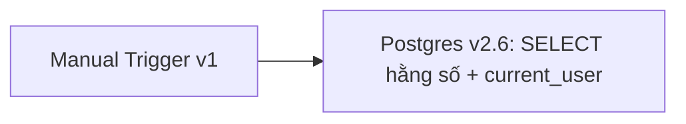

# N8N-01 — runtime local

## N8N-04 web chat (LOCAL chỉ đọc)

Hardening 09/11: **provider mặc định blocked kể cả có key**. Chỉ deployment biệt lập
`NODE_ENV=test` + `CHAT_PROVIDER_DATA_POLICY=synthetic-only` được gửi fixture tổng hợp;
không có mode cho dữ liệu khách thật. [Findings/gate rollout](../../docs/review-n8n-04-hardening.md),
[evidence mới](chat-hardening-evidence.json). Benchmark 10/10 bên dưới thuộc checksum lịch sử.
Không activate hoặc hot-import workflow vào runtime hiện có trong lượt review này.
Gate đóng phải cho `HUMAN/DATA_POLICY_BLOCKED`, không chạy hai model node; có thể
kiểm trường này trong Conversation bằng session test, không xuất full execution.
Hai model URL trong fault harness đều thay bằng HTTP fixture nội bộ và bỏ credential;
fixture success chỉ kiểm wiring/outbound, không là model inference.

Actual 09/11: model miễn phí cố định đã chạy thật qua n8n/IAM/Catalog/Class;
[benchmark 10/10 local](chat-benchmark-review.json), [evidence](chat-evidence.json).
Đã kiểm WF-03, browser có câu trả lời AI thật và fault injection 429/timeout/tool lỗi.
Manifest giữ trạng thái chưa promotion tự động; operator/reviewer vẫn phải review
trước activation hoặc đưa dữ liệu khách thật lên free provider.

[Runbook API/config/credential đầy đủ](../../services/conversation/README.md),
[manifest/bindings/checksum](chat-manifest.json), [actual evidence](../../docs/ban-giao-n8n-04.md).
WF-01/02/03 export ở trạng thái inactive. Import từng `wf-01.json`, `wf-02.json`,
`wf-03.json` bằng CLI `import:workflow --input=...` theo runtime bên dưới. Đổi các
địa chỉ `host.docker.internal:4001/4002/4004/4006/4007` theo deployment thật;
không đưa URL do khách/model cung cấp vào node. Sau đổi URL, lưu bản binding/checksum
riêng; giữ nguyên canonical JSON trong Git. Manual trigger dùng để smoke; schedule
5 giây chỉ chạy sau activation do operator thực hiện cho đúng instance.

Tạo n8n Custom Auth credentials đúng ID `N8N04WF-01Machine`, `N8N04WF-02Machine`,
`N8N04WF-03Machine`; JSON credential có `body.clientId/clientSecret` do IAM cấp.
Node token lấy JWT ngắn hạn mỗi execution; WF-02 lấy mới lần nữa trước submit.
Không import JWT tĩnh từ receipt smoke cũ để vận hành các workflow này.
Tạo Header Auth ID `N8N04FreeModel`, tên `llm-free-demo`, header Authorization với
Bearer key OpenRouter miễn phí. Không ghi key/client secret vào workflow JSON.

Chỉ bật `AI_FREE_MODEL_READY=true` ở Conversation sau khi cài credential. Model cố
định `nvidia/nemotron-3.5-lightning:free`, không paid fallback. Chưa có key thì nhánh MISSING_KEY vào
HUMAN; không được tính là AI live. Benchmark mười ca có ở `chat-benchmark.json`;
chạy test biệt lập bằng `npm run test:chat` từ root. Đường dẫn key tùy chọn ở biến
`N8N04_MODEL_KEY_FILE`; không cung cấp biến này thì provider không được gọi.

Tắt cả ba workflow trước khi đổi binding/version hoặc credential. Bridge giữ job
và version khi retry/recovery; không sửa input/context/owner bằng SQL để ép replay.
Replay vẫn qua IAM có quyền/lý do/CAS của runbook Bridge. 409 stale draft bị loại;
kiểm mode/owner hiện hành trên Portal trước thao tác tiếp. Receipt private chứa JWT
và lease; chỉ chia sẻ receipt đã che. Cleanup giới hạn project/volume test được ghi
trong evidence, không prune toàn máy.

Phạm vi: Community single instance, PostgreSQL riêng, key cố định, smoke kỹ thuật.
Không phải WF-01–12, không đọc/ghi DB nghiệp vụ. Xem [bằng chứng](../../docs/ban-giao-n8n-01.md).

## Khởi động

Yêu cầu Node.js 22+, Docker Engine đang chạy và Docker Compose v2. Chạy từ root repo:

```powershell
node scripts/n8n-local.mjs init
docker compose --env-file .local/n8n/runtime.env -p space-agent-n8n -f infra/n8n/compose.yml up -d --wait --wait-timeout 240
docker compose --env-file .local/n8n/runtime.env -p space-agent-n8n -f infra/n8n/compose.yml ps
curl.exe --fail http://localhost:5678/healthz/readiness
```

Mở <http://localhost:5678>, tự tạo owner ở lần mở đầu. Script không tạo tài khoản/password mặc định.
Nếu cổng bị chiếm, sửa **chỉ** `N8N_LOCAL_PORT` trong `.local/n8n/runtime.env`, rồi chạy lại `up`.
Không chạy stack này bằng project name của hạ tầng khác.

`init` dùng create-exclusive: chạy lại không đổi password/key. Không đọc hoặc ghi `.env` cá nhân.
Secret nằm trong `.local/n8n/runtime.env` đã được `.gitignore` hiện hữu loại trừ. Trên Windows,
file mode `0600` của Node không thay thế NTFS ACL: giữ thư mục trong tài khoản cá nhân, bảo vệ bản backup.
Không in `docker compose config` đầy đủ hoặc `docker inspect` environment vào log chia sẻ.

Ghim cả version và digest: n8n `2.46.4`, PostgreSQL `17.7-alpine`; digest thực chạy được ghi trong evidence.
PostgreSQL không publish port; DB `n8n`, runtime role `n8n` không superuser/createdb/createrole;
`n8n_admin` chỉ dùng bootstrap/vận hành. Volume `space-agent-n8n_postgres_data` và
`space-agent-n8n_n8n_data` độc lập với `infra_pgdata` và mọi DB service cũ.
Editor bind loopback, HTTP/cookie không secure chỉ dành local; không public hoặc dùng tunnel cấu hình này.

Timezone `Asia/Ho_Chi_Minh`, giới hạn production execution 2. Giới hạn này không bao gồm manual/CLI;
lease/concurrency cuối cùng đã có trong [Bridge N8N-02 LOCAL](../../services/automation-bridge/README.md),
kiểm chứng trên stack test riêng, chưa nối workflow nghiệp vụ. Execution payload không lưu cả khi thành công/lỗi/manual;
pruning bật 168 giờ, hard-delete mỗi 1440 phút. Evidence đã che lưu riêng; chưa đo pruning bằng chờ 7 ngày.
Không có broker/queue mode, provider, paid fallback hay AI assistant sandbox trong N8N-01.

## Kiểm chứng tự động

```powershell
docker compose --env-file .local/n8n/runtime.env -p space-agent-n8n -f infra/n8n/compose.yml pull
node scripts/n8n-local.mjs smoke
```

Mỗi lần tạo project `space-agent-n8n-smoke-<random>` cùng env, DB, key và volume mới;
không import vào instance người dùng. Cổng loopback được chọn khi chạy; nếu bị chiếm giữa bước chọn/start,
script thất bại an toàn, chạy lại để lấy project mới.

Assertions kiểm readiness/version, DB trống, runtime role không đặc quyền, import fixture, credential
được lưu mã hóa và truy vấn PostgreSQL thật trả `{marker: 'N8N-01', db_user: 'n8n'}`.
Sau đó export JSON thật, reimport thành ID mới, restart cả PostgreSQL/n8n, kiểm đủ hai workflow
và chạy lại query bằng credential cũ; cuối cùng force-recreate container và query lần nữa.
Không export credential plaintext. Credential input được tạo trong volume test với mode 0600,
import rồi xóa trong `finally`; nếu process bị kill trước cleanup, volume test có thể còn input này.

Evidence, workflow export và log lỗi riêng nằm trong `.local/n8n/<project>/`.
Script `down` project test khi kết thúc, **giữ volume và key** để kiểm tra lại; runtime chính vẫn chạy.
Để xem lại một lần smoke, dùng đúng env file và `-p <project>` trong các lệnh Compose trên.
Không dùng `down -v` hoặc `docker volume prune`. Chỉ dọn tài nguyên test sau khi xác minh đúng project,
backup evidence cần giữ và quyết định bỏ dữ liệu test; script không tự xóa volume.

## Workflow và credential map



`runtime-smoke.json` là fixture tổng hợp không secret, trigger manual, không subflow, input schema 1,
workflow version 1, settings timezone VN. SHA-256 và n8n version thử nghiệm nằm trong `manifest.json`.
Alias `runtime-smoke-postgres` / ID `N8N01Postgres` thuộc test; host `postgres`, port `5432`, DB/user `n8n`,
SSL disable trong network Docker local; password lấy từ env test, không phải credential nghiệp vụ.

Import UI: **Import from File** với `runtime-smoke.json`, tạo PostgreSQL credential theo map,
gán lại credential tại node, rồi **Execute Workflow**. Không cần publish vì manual trigger.
Nếu import vào instance có dữ liệu, bỏ/đổi workflow ID và remap credential để tránh ghi đè.
CLI quản trị bỏ qua quyền UI: chỉ operator dùng. Script chỉ gọi CLI trên project test mới tạo.
Alias `bridge-runtime`, `domain-runtime`, `llm-free-demo` chưa cấp, không thay bằng token admin.

Smoke Bridge N8N-02: [JSON](bridge-smoke.json), [manifest](bridge-manifest.json),
[receipt đã che](bridge-evidence.json), [runbook](../../services/automation-bridge/README.md).
Manual Trigger → HTTP claim → HTTP checkpoint → HTTP result, timeout 10 giây, node retry tắt.
Credential alias `bridge-smoke-machine` / ID `N8N02BridgeMachine`, type `httpHeaderAuth`:
header Authorization chứa Bearer token RS256 ≤5 phút, audience automation-bridge,
subject n8n-smoke/workflow bridge-smoke; các scope `automation:claim/checkpoint/result/authorize`
ghi đầy đủ từng prefix. IAM HTTP thật cấp token và kiểm introspection/revocation, không dùng
fixture signer làm runtime. Không import credential
hoặc JSON smoke vào runtime N8N-01 có sẵn. Chạy `npm run test:automation` để tạo stack mới.

Smoke N8N-03: [JSON import được](iam-read-smoke.json),
[manifest/checksum](iam-read-manifest.json), [receipt đã che](iam-read-evidence.json),
[bàn giao và giới hạn](../../docs/ban-giao-n8n-03.md).
Manual claim → Catalog intent/authorize → Catalog courses → Class intent/authorize
→ Class list → DONE. Token domain IAM 30s chỉ nằm trong HTTP response/execution;
JSON không chứa token/secret. Cùng harness chạy lại 11 ca N8N-02 và 12 ca N8N-03,
không activate business workflows hoặc thay runtime N8N-01.

## Dừng, backup và nâng phiên bản

```powershell
docker compose --env-file .local/n8n/runtime.env -p space-agent-n8n -f infra/n8n/compose.yml stop
docker compose --env-file .local/n8n/runtime.env -p space-agent-n8n -f infra/n8n/compose.yml up -d --wait
```

Không đổi key trên DB đã có credential; không xóa hoặc tạo lại `runtime.env` để sửa lỗi kết nối.
Mất key có thể làm credential không đọc được dù workflow vẫn còn. Backup file env ra nơi bảo mật
ngoài repo, lưu riêng với bản dump DB; backup cả volume `.n8n` và cấu hình Compose/workflow.
Ví dụ dump binary không qua redirect PowerShell:

```powershell
docker compose --env-file .local/n8n/runtime.env -p space-agent-n8n -f infra/n8n/compose.yml exec -T postgres pg_dump -U n8n_admin -d n8n -Fc -f /tmp/n8n-backup.dump
docker compose --env-file .local/n8n/runtime.env -p space-agent-n8n -f infra/n8n/compose.yml cp postgres:/tmp/n8n-backup.dump .local/n8n/n8n-backup.dump
```

Dump chứa credential mã hóa và dữ liệu instance: không commit/chia sẻ. JSON workflow không thay thế backup.
Trước upgrade: dừng trigger, backup DB/key/volume, thử version mới trong project/volume biệt lập,
chạy smoke rồi cập nhật pin và manifest. Không downgrade DB đã migration bằng image cũ.
Full backup/restore sang instance sạch, lịch backup tự động và RPO/RTO thuộc N8N-08/OPS-1, chưa được smoke này chứng minh.

Nguồn chính thức đã đối chiếu:
[Docker](https://docs.n8n.io/hosting/installation/docker/),
[CLI import/export/execute](https://docs.n8n.io/hosting/cli-commands/),
[release stable](https://github.com/n8n-io/n8n/releases/tag/stable).
